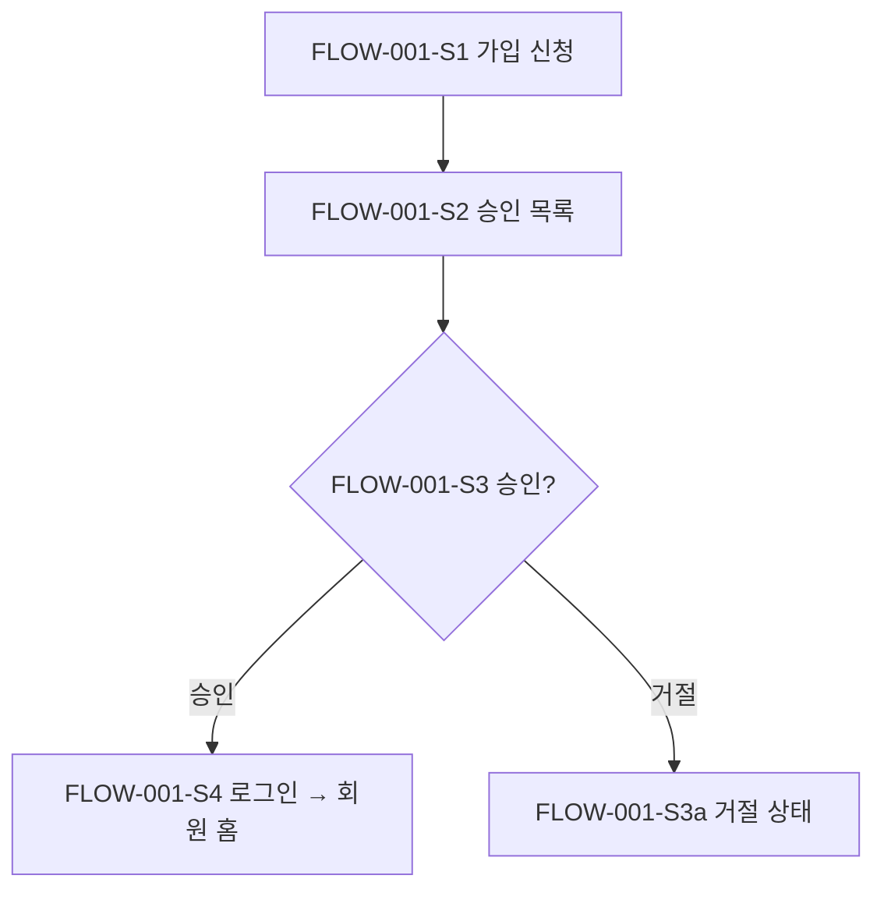
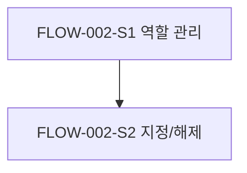
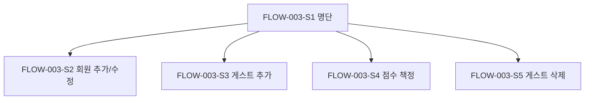
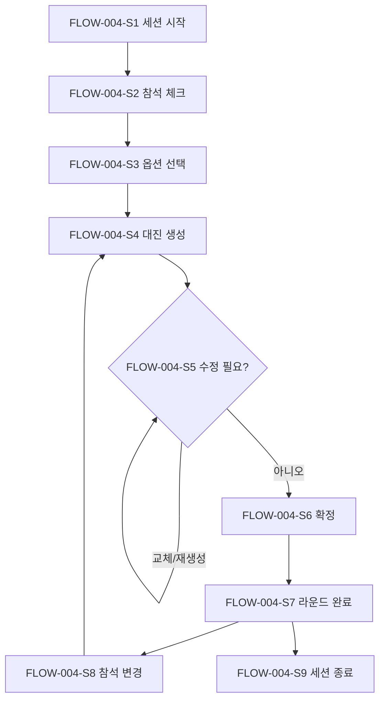
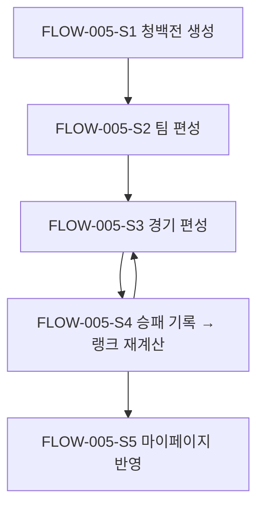
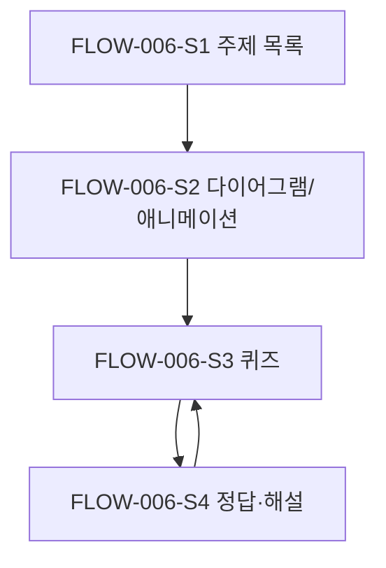
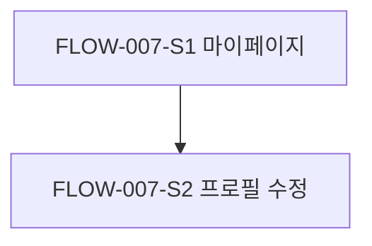

# 사용자 플로우 (User Flows): badminton-playbook

## FLOW-001: 가입 신청 → 승인 → 로그인

- **행위자**: PER-001 회원, PER-002 운영진
- **커버하는 스토리**: US-001, US-002, US-003
- **진입 조건**: 아직 가입하지 않은 사람이 서비스에 접속합니다.
- **종료 / 성공 상태**: 승인된 회원이 로그인해 회원 홈(학습, 마이페이지)에 들어갑니다.

| 단계 | 사용자 행동 | 시스템 반응 |
|---|---|---|
| FLOW-001-S1 | 회원이 가입 화면에서 이름, 성별, 로그인 정보를 입력하고 제출합니다. | 입력값을 검사하고 계정을 '승인 대기' 상태로 만듭니다. "운영진 승인 후 이용할 수 있습니다"라고 안내합니다. |
| FLOW-001-S2 | 운영진이 가입 승인 목록을 엽니다. | 승인 대기 중인 신청자를 신청 순서대로 보여 줍니다. |
| FLOW-001-S3 | 운영진이 신청자를 승인합니다. | 계정을 '승인'으로 바꾸고 회원 명단에 넣습니다. 점수는 '미설정'으로 둡니다. |
| FLOW-001-S4 | 회원이 로그인합니다. | 역할을 확인하고 회원 홈으로 보냅니다. 운영진 이상이면 운영 메뉴도 보여 줍니다. |

**대안 / 오류 경로**

- FLOW-001-S1a: 필수값이 비어 있거나 로그인 정보가 이미 쓰이고 있으면 오류를 보여 주고 다시 입력하게 합니다.
- FLOW-001-S3a: 운영진이 거절하면 계정을 '거절' 상태로 바꿉니다. 이 계정으로는 로그인해도 회원 기능을 쓸 수 없습니다.
- FLOW-001-S4a: 승인 대기 중이거나 거절된 계정으로 로그인하면, 회원 기능 대신 계정 상태 안내를 보여 줍니다.

## FLOW-002: 운영진 지정과 해제

- **행위자**: PER-003 슈퍼 관리자
- **커버하는 스토리**: US-004
- **진입 조건**: 슈퍼 관리자가 로그인해 있습니다.
- **종료 / 성공 상태**: 대상 회원의 역할이 바뀌고, 바뀐 역할이 다음 요청부터 적용됩니다.

| 단계 | 사용자 행동 | 시스템 반응 |
|---|---|---|
| FLOW-002-S1 | 슈퍼 관리자가 역할 관리 화면을 엽니다. | 승인된 회원 목록과 각 회원의 역할을 보여 줍니다. |
| FLOW-002-S2 | 회원을 골라 '운영진 지정' 또는 '운영진 해제'를 누릅니다. | 확인 창을 띄운 뒤 역할을 바꾸고 결과를 보여 줍니다. |

**대안 / 오류 경로**

- FLOW-002-S1a: 운영진이 역할 관리 화면에 접근하면 권한 오류를 보여 주고, 화면 진입과 API 호출을 모두 막습니다.

## FLOW-003: 회원 명단, 게스트, 점수 관리

- **행위자**: PER-002 운영진
- **커버하는 스토리**: US-005, US-006, US-007
- **진입 조건**: 운영진이 로그인해 있습니다. PC와 모바일 모두에서 진행할 수 있습니다.
- **종료 / 성공 상태**: 회원과 게스트 정보, 점수가 저장됩니다.

| 단계 | 사용자 행동 | 시스템 반응 |
|---|---|---|
| FLOW-003-S1 | 운영진이 명단 화면을 엽니다. | 회원과 게스트를 구분해 이름, 성별, 점수를 보여 줍니다. |
| FLOW-003-S2 | '회원 추가'로 이름, 성별, 점수를 입력하거나 기존 회원 정보를 수정합니다. | 입력값을 검사해 저장하고 명단에 반영합니다. |
| FLOW-003-S3 | '게스트 추가'로 이름, 성별, 점수를 입력합니다. | 게스트로 저장합니다. 게스트는 랭크 대상에서 빠집니다. |
| FLOW-003-S4 | 회원이나 게스트의 점수를 1–10 중에서 고릅니다. | 점수를 저장합니다. |
| FLOW-003-S5 | 게스트를 삭제합니다. | 확인 창을 띄운 뒤 게스트를 지우고, 지난 기록에는 '삭제된 게스트'로 표시합니다(ASM-019). |

**대안 / 오류 경로**

- FLOW-003-S4a: 1–10 범위를 벗어난 값이나 정수가 아닌 값은 저장하지 않고 오류를 보여 줍니다.
- FLOW-003-S5a: 진행 중인 라운드에 출전한 게스트는 삭제할 수 없습니다. 라운드가 끝난 뒤에 삭제하라고 안내합니다.

## FLOW-004: 운동 당일 실시간 대진 (핵심 플로우)

- **행위자**: PER-002 운영진
- **커버하는 스토리**: US-008, US-009, US-010, US-011, US-012, US-013
- **진입 조건**: 운영진이 로그인해 있고, 회원과 게스트의 점수와 성별이 등록되어 있습니다.
- **종료 / 성공 상태**: 그날 여러 라운드를 진행했고, 같은 날 같은 경기가 반복되지 않았으며, 게임 수가 고르게 배분됐습니다.

| 단계 | 사용자 행동 | 시스템 반응 |
|---|---|---|
| FLOW-004-S1 | 운영진이 '오늘 운동 시작'으로 세션을 엽니다. | 오늘 날짜의 세션을 만들고 참석 체크 화면을 보여 줍니다. |
| FLOW-004-S2 | 회원 명단에서 참석자를 체크하고, 필요하면 게스트를 추가합니다. | 참석 인원과 성별 분포를 보여 줍니다. |
| FLOW-004-S3 | 생성 방식(레벨별 또는 무작위)을 고르고, 규칙 4가지를 켜거나 끕니다. | 옵션을 저장합니다. 다음 라운드에서도 같은 옵션을 기본으로 씁니다. |
| FLOW-004-S4 | '대진 생성'을 누릅니다. | 공평성 기준으로 출전자를 고르고, 코트 수(4)만큼 경기를 생성합니다. 남는 인원은 대기자로 표시합니다. 완화된 규칙이 있으면 경기별로 표시합니다. |
| FLOW-004-S5 | 대진을 검토하고, 필요하면 선수를 맞바꾸거나 '다시 생성'을 누릅니다. | 바뀐 대진을 보여 줍니다. 다시 생성하면 새 시드로 새 결과를 만듭니다. |
| FLOW-004-S6 | '확정'을 누릅니다. | 라운드를 '진행 중'으로 바꾸고 코트별 경기를 보여 줍니다. |
| FLOW-004-S7 | 4경기가 모두 끝나면 '라운드 완료'를 누릅니다. | 게임 수, 파트너, 상대, 대기 기록을 세션 이력에 쌓습니다. |
| FLOW-004-S8 | 늦게 온 사람을 참석에 추가하거나 먼저 간 사람을 뺀 뒤, 다시 S4로 돌아갑니다. | 바뀐 참석자와 세션 이력을 반영해 다음 라운드를 생성합니다. 직전 라운드 대기자를 먼저 배정합니다. |
| FLOW-004-S9 | 운동이 끝나면 '세션 종료'를 누릅니다. | 세션을 종료합니다. 종료된 세션에서는 더 이상 라운드를 생성할 수 없습니다. |

**대안 / 오류 경로**

- FLOW-004-S4a: 참석자가 4명 미만이면 대진을 생성하지 않고 "최소 4명이 필요합니다"라고 안내합니다.
- FLOW-004-S4b: 참석자가 16명 미만이거나 4의 배수가 아니면, 4명 단위로 채울 수 있는 코트만큼만 경기를 만들고 나머지는 대기자로 표시합니다.
- FLOW-004-S4c: 켜진 규칙을 모두 만족할 수 없으면 우선순위가 낮은 규칙부터 완화하고, 어떤 규칙이 완화됐는지 표시합니다(US-013).
- FLOW-004-S6a: 확정하는 순간 다른 운영진이 같은 세션을 이미 바꿨다면, 충돌을 안내하고 최신 상태를 다시 불러옵니다(Q-016).
- FLOW-004-S8a: 진행 중인 라운드에서 선수를 참석에서 빼도 현재 경기는 그대로 둡니다. 그 선수는 다음 라운드부터 빠집니다(ASM-016).

## FLOW-005: 청백전 운영과 랭크 반영

- **행위자**: PER-002 운영진, PER-001 회원
- **커버하는 스토리**: US-014, US-015, US-016
- **진입 조건**: 운영진이 로그인해 있습니다.
- **종료 / 성공 상태**: 청백전 경기별 승패가 기록되고, 참가 회원의 랭크가 다시 계산됩니다.

| 단계 | 사용자 행동 | 시스템 반응 |
|---|---|---|
| FLOW-005-S1 | 운영진이 청백전 메뉴에서 '청백전 만들기'를 누르고 날짜와 이름을 입력합니다. | 청백전을 만듭니다. 일반 운동 세션과는 따로 저장합니다. |
| FLOW-005-S2 | 참가자를 골라 청팀과 백팀에 배정합니다. | 팀별 인원을 보여 줍니다. |
| FLOW-005-S3 | 청팀 2명과 백팀 2명을 골라 경기를 추가합니다. | 경기 목록에 추가합니다. |
| FLOW-005-S4 | 경기가 끝나면 이긴 팀(청 또는 백)을 선택합니다. | 승패를 저장하고, 해당 경기에 나온 회원의 전적과 랭크를 다시 계산합니다. |
| FLOW-005-S5 | 회원이 마이페이지를 엽니다. | 바뀐 랭크와 전적을 보여 줍니다(FLOW-007). |

**대안 / 오류 경로**

- FLOW-005-S3a: 같은 팀 선수끼리 상대로 편성하거나 한 경기에 같은 선수를 두 번 넣으면 저장하지 않고 오류를 보여 줍니다.
- FLOW-005-S4a: 승패를 잘못 기록했으면 수정할 수 있습니다. 수정하면 랭크를 다시 계산합니다.
- FLOW-005-S2a: 게스트를 참가시킬 수 있는지는 Q-015에서 정합니다.

## FLOW-006: 로테이션 학습과 퀴즈

- **행위자**: PER-001 회원
- **커버하는 스토리**: US-017, US-018
- **진입 조건**: 승인된 회원이 로그인해 있습니다. 화면은 모바일 레이아웃입니다.
- **종료 / 성공 상태**: 회원이 주제를 학습하고 퀴즈를 풀어 정답과 해설을 확인합니다.

| 단계 | 사용자 행동 | 시스템 반응 |
|---|---|---|
| FLOW-006-S1 | 회원이 학습 메뉴를 엽니다. | 4개 주제(공격 대형, 수비 대형, 전환, 서브·리시브)를 보여 줍니다. |
| FLOW-006-S2 | 주제를 고릅니다. | 코트 다이어그램과 애니메이션으로 선수의 위치와 이동을 보여 줍니다. 재생, 일시정지, 다시 보기를 할 수 있습니다. |
| FLOW-006-S3 | '퀴즈 풀기'를 누릅니다. | 상황 다이어그램과 선택지를 보여 줍니다. |
| FLOW-006-S4 | 답을 고릅니다. | 바로 정답 여부와 해설을 보여 줍니다. 결과는 저장하지 않습니다. |

**대안 / 오류 경로**

- FLOW-006-S1a: 로그인하지 않았거나 승인되지 않은 사용자가 학습 페이지에 접근하면 로그인 화면이나 계정 상태 안내로 보냅니다.

## FLOW-007: 마이페이지

- **행위자**: PER-001 회원
- **커버하는 스토리**: US-019, US-016
- **진입 조건**: 승인된 회원이 로그인해 있습니다.
- **종료 / 성공 상태**: 회원이 자기 프로필, 랭크, 청백전 전적을 확인하고, 필요하면 프로필을 수정합니다.

| 단계 | 사용자 행동 | 시스템 반응 |
|---|---|---|
| FLOW-007-S1 | 회원이 마이페이지를 엽니다. | 프로필(이름, 성별 등), 랭크(또는 '랭크 없음'과 남은 경기 수), 청백전 전적(경기 수, 승, 패, 승률)을 보여 줍니다. 1–10 점수는 보여 주지 않습니다. |
| FLOW-007-S2 | 프로필 수정에서 이름 등을 바꾸고 저장합니다. | 입력값을 검사해 저장합니다. |

**대안 / 오류 경로**

- FLOW-007-S1a: 청백전 기록이 없으면 "청백전 기록이 없습니다"를 보여 줍니다.

## UI 플로우가 없는 스토리 (Stories without UI flow)

없음. US-016(랭크 산정)은 시스템이 하는 계산이지만, FLOW-005-S4(재계산)와 FLOW-007-S1(표시)에 포함됩니다.
