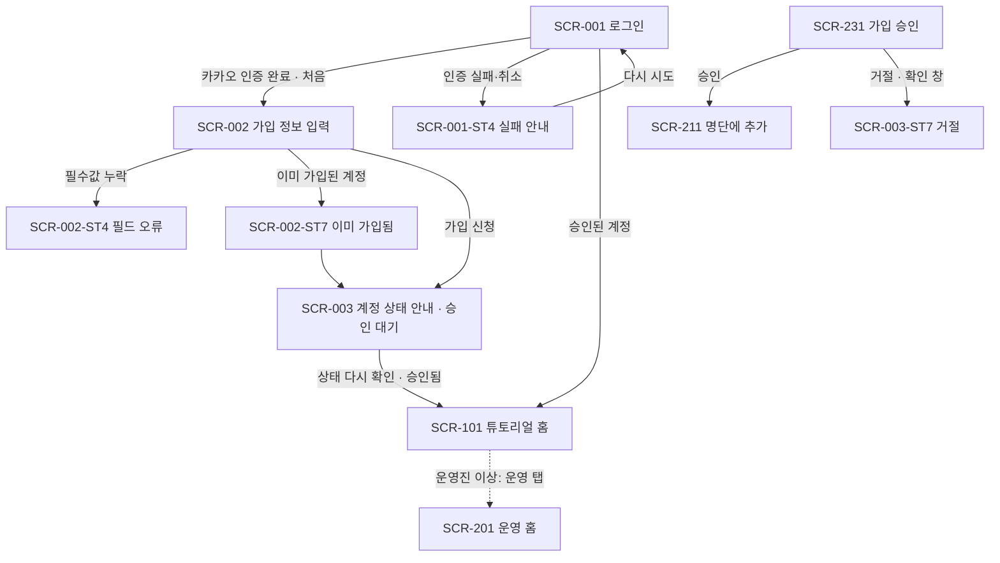
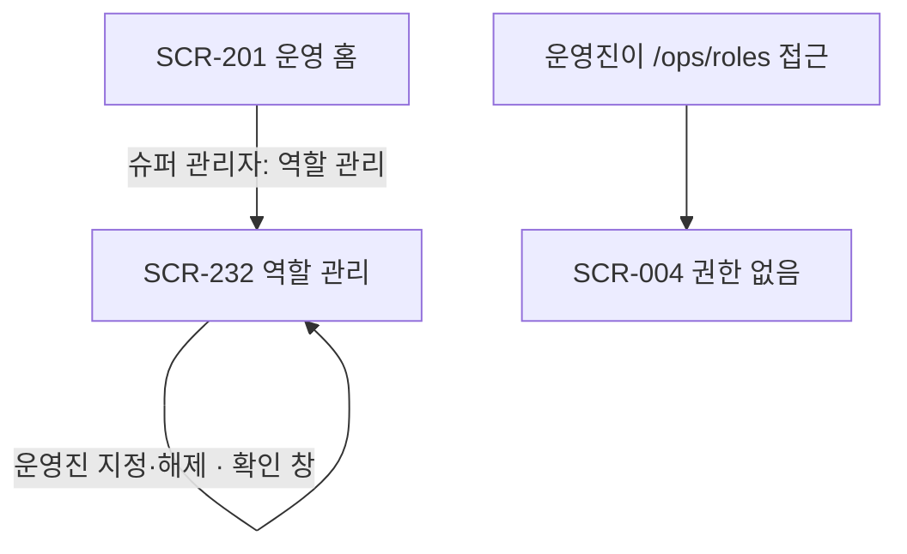
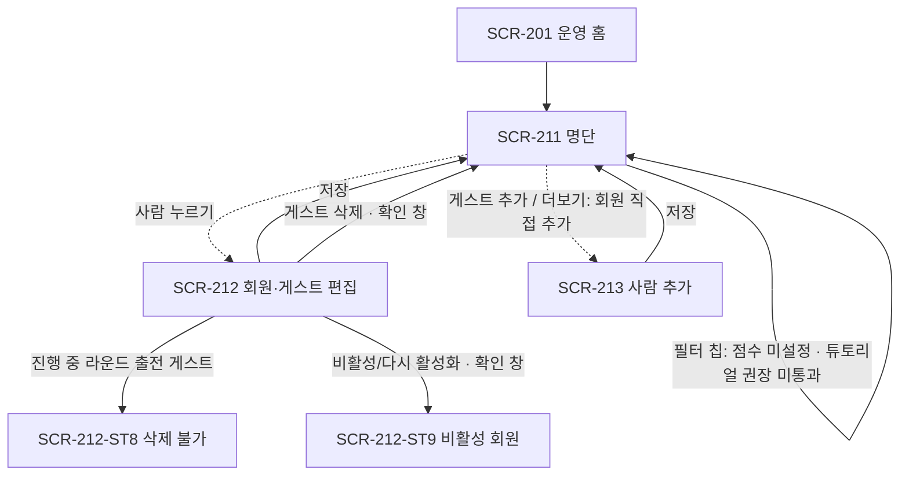
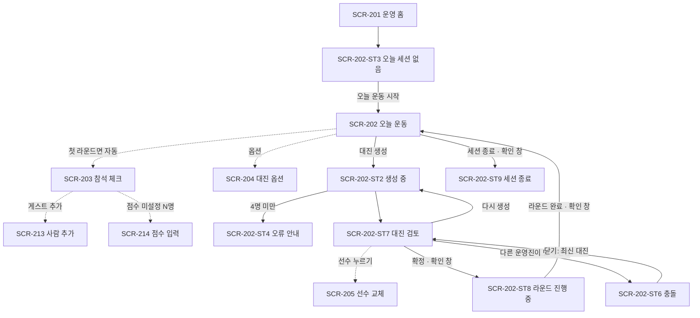
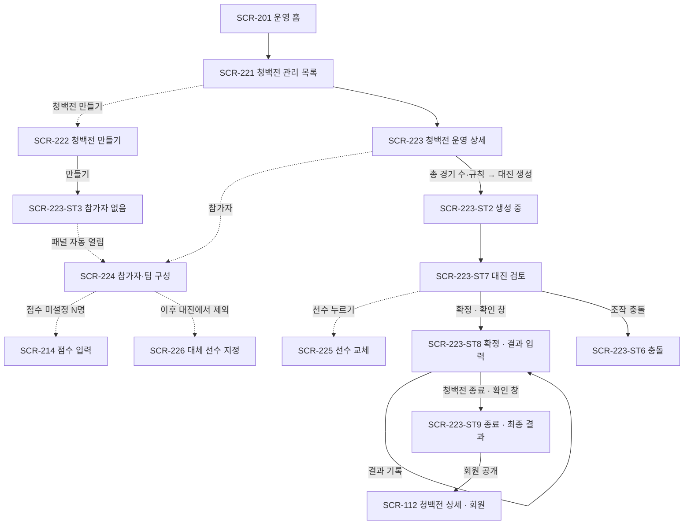
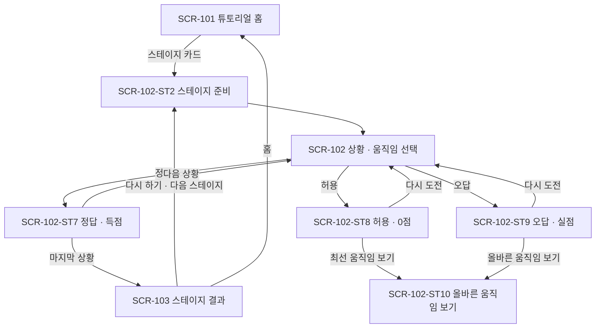
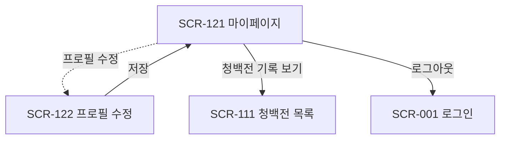
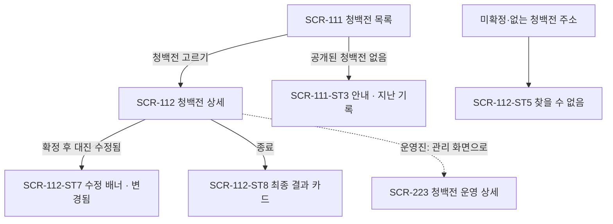

# 화면 이동 흐름 (Screen Flows): 배드민턴 플레이북 (badminton-playbook)

기획의 User Flow(`04-user-flows.md`, r3)를 화면 단위로 옮깁니다. 기획의 FLOW 단계 74개(대안·오류 경로 포함)를 모두 아래 대응표에 둡니다.
상태 ID는 `01` 6.2의 고정 번호(ST1 기본, ST2 로딩, ST3 빈 상태, ST4 오류, ST5 권한 없음, ST6 충돌, ST7– 고유 상태)와 `02`의 화면별 상태 정의를 따릅니다.
시트·패널은 부모 화면 위에 열리므로 흐름도에서 점선(`-.->`)으로 표시합니다.

## FLOW-001: 가입 신청 → 승인 → 로그인

### FLOW 단계 → 화면 대응

| FLOW 단계 | 화면·상태 | 비고 |
|---|---|---|
| FLOW-001-S1 | SCR-001-ST1, SCR-001-ST2, SCR-002-ST1, SCR-002-ST2 | 카카오 인증 → 가입 정보 입력(급수 8개 버튼, 지인 선택) → 제출 |
| FLOW-001-S2 | SCR-201-ST1, SCR-231-ST1 | 운영 홈 '가입 승인'(대기 건수 배지) → 신청 순서 목록(이름·성별·급수·지인) |
| FLOW-001-S3 | SCR-231-ST1 | 개별 '승인' 또는 체크 후 일괄 승인. 승인된 회원은 SCR-211에 점수 미설정으로 나타남 |
| FLOW-001-S4 | SCR-001-ST2, SCR-101-ST1 | 역할 확인 후 튜토리얼 홈(회원 홈). 운영진 이상은 하단 '운영' 탭이 함께 보임 |
| FLOW-001-S1a | SCR-002-ST4 | 이름·성별·급수 중 빈 항목 아래 오류. 지인은 비워도 됨 |
| FLOW-001-S1b | SCR-002-ST7, SCR-003-ST1, SCR-101-ST1 | 새 계정을 만들지 않고 기존 계정 상태에 맞는 화면으로 이동 |
| FLOW-001-S1c | SCR-001-ST4 | 실패 안내 상자와 '다시 시도'. 2회 이상 실패 시 다른 브라우저 안내(UXD-019) |
| FLOW-001-S3a | SCR-231-ST1, SCR-003-ST7 | 한 명씩 확인 창을 거쳐 거절. 거절된 계정은 로그인하면 거절 안내 |
| FLOW-001-S4a | SCR-003-ST1, SCR-003-ST7, SCR-003-ST8 | 승인 대기·거절·비활성 안내와 '상태 다시 확인'·로그아웃 |

## FLOW-002: 운영진 지정과 해제

### FLOW 단계 → 화면 대응

| FLOW 단계 | 화면·상태 | 비고 |
|---|---|---|
| FLOW-002-S1 | SCR-201-ST1, SCR-232-ST1, SCR-232-ST2 | 슈퍼 관리자에게만 메뉴가 보임. 역할별 묶음 목록과 이름 검색 |
| FLOW-002-S2 | SCR-232-ST1, SCR-232-ST4 | 행의 '운영진 지정'·'운영진 해제' → 확인 창 → 결과 반영. 실패 시 오류 문구 |
| FLOW-002-S1a | SCR-232-ST5, SCR-004-ST1 | 운영진에게는 메뉴를 숨기고, 주소로 들어오면 권한 없음. 서버도 거부 |

## FLOW-003: 회원 명단, 게스트, 점수 관리

### FLOW 단계 → 화면 대응

| FLOW 단계 | 화면·상태 | 비고 |
|---|---|---|
| FLOW-003-S1 | SCR-211-ST1, SCR-211-ST2, SCR-211-ST3 | 회원(이름순)·게스트 구분, 행에 이름·성별·급수·점수(UXD-074) |
| FLOW-003-S2 | SCR-213-ST7, SCR-212-ST1 | 회원 직접 추가(더보기, 예외 경로)와 기존 회원 수정(급수 포함) |
| FLOW-003-S3 | SCR-213-ST1 | 게스트 추가: 이름·성별·급수·점수. 게스트는 랭크 대상 아님 |
| FLOW-003-S4 | SCR-212-ST1, SCR-212-ST7 | 1–10 숫자 버튼(5개씩 두 줄). 참석·참가 중에는 SCR-214에서도 매김(FLOW-005-S2b) |
| FLOW-003-S5 | SCR-212-ST7, SCR-211-ST1 | 시트 아래쪽 '게스트 삭제' → 확인 창 → 명단에서 사라지고 지난 기록은 '삭제된 게스트' |
| FLOW-003-S6 | SCR-212-ST1, SCR-212-ST9, SCR-211-ST1 | 비활성 처리·다시 활성화(확인 창). 명단은 '비활성 포함' 토글로 비활성 회원을 보여 줌(UXD-024) |
| FLOW-003-S7 | SCR-211-ST1, SCR-212-ST1, SCR-212-ST7 | '튜토리얼 권장 · 미통과 N명' 칩(UXD-073) → 행 → 편집 시트에서 급수·지인·랭크·전적·튜토리얼 현황. 게스트는 현황 없음 |
| FLOW-003-S2a | SCR-212-ST4, SCR-213-ST4 | 급수를 고르지 않으면 저장하지 않고 필드 아래 오류 |
| FLOW-003-S4a | SCR-212-ST4, SCR-214-ST4 | 버튼 입력이라 범위 밖 값은 화면에서 만들 수 없음. 서버 거부 시 오류 문구 |
| FLOW-003-S5a | SCR-212-ST8 | 삭제 버튼 비활성과 '라운드가 끝난 뒤 삭제하세요' 안내 |

## FLOW-004: 운동 당일 실시간 대진 (핵심 플로우)

### FLOW 단계 → 화면 대응

| FLOW 단계 | 화면·상태 | 비고 |
|---|---|---|
| FLOW-004-S1 | SCR-202-ST3, SCR-202-ST1 | '오늘 운동 시작' → 세션 생성, 첫 라운드면 참석 패널 자동 열림(UXD-002) |
| FLOW-004-S2 | SCR-203-ST1, SCR-213-ST1 | 참석 인원·성별 분포 고정 표시. 패널에서 추가한 게스트는 바로 참석 체크(UXD-027) |
| FLOW-004-S3 | SCR-204-ST1 | 생성 방식 하나 + 규칙 4개. 다음 라운드 기본값 유지 |
| FLOW-004-S4 | SCR-202-ST2, SCR-202-ST7 | 코트 카드(1팀/2팀, 점수, 팀 점수 합, 실력차), 대기자, 완화 표시. 점수 미설정이 있으면 생성 버튼 비활성(UXD-023) |
| FLOW-004-S5 | SCR-202-ST7, SCR-205-ST1 | '다시 생성'(Must), 선수 맞바꾸기(Should, 대상별 교체 후 예상 실력차) |
| FLOW-004-S6 | SCR-202-ST7, SCR-202-ST8 | '확정' → 확인 창 → 진행 중. 확정 후에도 실력차 표시 |
| FLOW-004-S7 | SCR-202-ST8, SCR-202-ST1 | '라운드 완료' → 확인 창 → 지난 라운드 목록(접힘)에 쌓이고 다음 라운드 준비 |
| FLOW-004-S8 | SCR-203-ST1, SCR-202-ST1 | 참석 추가·제외 후 다시 생성. 직전 라운드 대기자 우선 |
| FLOW-004-S9 | SCR-202-ST9 | '세션 종료' → 확인 창 → 생성 버튼 없음 |
| FLOW-004-S4a | SCR-202-ST4 | "최소 4명이 필요합니다" 안내, 생성하지 않음 |
| FLOW-004-S4b | SCR-202-ST7 | 채울 수 있는 코트만 경기 카드, 나머지는 대기자 섹션 |
| FLOW-004-S4c | SCR-202-ST7 | 상단 한 줄 완화 요약 + 코트 카드 배지(누르면 설명), '성별 규칙 완화'(UXD-007) |
| FLOW-004-S6a | SCR-202-ST6 | 충돌 확인 창("확정은 처리되지 않았습니다") → 닫으면 최신 대진(UXD-010) |
| FLOW-004-S8a | SCR-203-ST1, SCR-202-ST8 | 진행 중 경기는 그대로, 다음 라운드부터 빠짐 |

## FLOW-005: 청백전 운영과 결과 반영 (r3)

### FLOW 단계 → 화면 대응

| FLOW 단계 | 화면·상태 | 비고 |
|---|---|---|
| FLOW-005-S1 | SCR-221-ST1, SCR-222-ST1, SCR-222-ST2 | '개인전 \| 팀전' 토글, 날짜, 이름 → 만들면 운영 상세로 이동 |
| FLOW-005-S2 | SCR-223-ST3, SCR-224-ST1, SCR-224-ST7, SCR-224-ST2 | 개인전 '참가' 체크 / 팀전은 알고리즘 배정안을 먼저 채우고 '청/백/불참'으로 조정 |
| FLOW-005-S3 | SCR-223-ST1, SCR-223-ST2, SCR-223-ST7, SCR-225-ST1 | 총 경기 수·규칙 입력과 균등안 미리보기(UXD-071) → 전체 대진 생성 → 다시 생성·교체 |
| FLOW-005-S6 | SCR-223-ST7, SCR-223-ST8 | '확정' → 확인 창 → '확정됨(회원 공개)'. 방식 토글·다시 생성 비활성 |
| FLOW-005-S4 | SCR-223-ST8 | 팀전 '청 승/백 승', 개인전 '승'. 순위 요약 카드·팀 승수 즉시 갱신 |
| FLOW-005-S7 | SCR-224-ST8, SCR-226-ST1 | '이후 대진에서 제외'('귀가' 표시) → 남은 경기마다 대체 선수(경기 수 적은 순) → 회원 화면 수정 표시 |
| FLOW-005-S8 | SCR-223-ST8, SCR-223-ST9 | '청백전 종료' → 확인 창 → 최종 결과 카드(UXD-072) |
| FLOW-005-S5 | SCR-112-ST1, SCR-112-ST8, SCR-121-ST1 | 회원은 청백전 상세에서 대진·결과·순위/팀 승수, 마이페이지에서 랭크·전적 |
| FLOW-005-S2a | SCR-224-ST1, SCR-224-ST7 | 게스트도 참가·팀 배정. 순위표에 '게스트' 표시 |
| FLOW-005-S2b | SCR-223-ST4, SCR-214-ST1 | '점수 미설정 N명' 안내와 대진 생성 비활성 → 그 자리에서 점수 입력 |
| FLOW-005-S3a | SCR-225-ST1, SCR-223-ST7 | 같은 4명·같은 팀 구성, 팀전 청 2 대 백 2 위반이 되는 교체 대상은 비활성과 사유 |
| FLOW-005-S3b | SCR-223-ST1 | 입력칸 아래 분포 미리보기, 균등안 버튼과 '입력값 유지'(UXD-071) |
| FLOW-005-S3c | SCR-223-ST7, SCR-223-ST1 | 확정 전 방식 변경 → 확인 창 → 미확정 대진 버림, 참가자 유지, 팀 배정 초기화. 팀 변경 시 재생성 확인(UXD-070) |
| FLOW-005-S3d | SCR-225-ST1 | 경기 수 차이 2 이상이 되는 교체는 경고만 하고 허용. 개별 경기 추가·삭제 없음 |
| FLOW-005-S6a | SCR-223-ST6, SCR-225-ST6, SCR-226-ST6 | 확정·교체·결과·방식 변경·종료 충돌 → 처리하지 않고 확인 창 → 최신 상태 |
| FLOW-005-S6b | SCR-223-ST8, SCR-225-ST1, SCR-224-ST8 | 확정 후에는 결과 없는 경기의 선수 교체만. 팀 변경 잠금 |
| FLOW-005-S4a | SCR-223-ST8, SCR-223-ST9 | 기록된 결과를 반대로 바꿀 때만 확인 창. 종료 후에도 수정하면 최종 결과 카드 재계산 |
| FLOW-005-S4b | SCR-223-ST7 | 확정 전에는 결과 버튼을 표시하지 않음 |
| FLOW-005-S8a | SCR-223-ST4 | 종료 버튼 비활성과 '결과 미기록 n경기' 안내(누르면 해당 경기로 이동) |
| FLOW-005-S8b | SCR-223-ST9, SCR-112-ST8 | 팀 승수가 같으면 '무승부 (5 : 5)'. 결정전 없음 |

## FLOW-006: 게임형 로테이션 튜토리얼 (r3)

### FLOW 단계 → 화면 대응

| FLOW 단계 | 화면·상태 | 비고 |
|---|---|---|
| FLOW-006-S1 | SCR-101-ST1, SCR-101-ST2, SCR-101-ST3 | 공통 안내, 난이도별 섹션·진행률, 스테이지 카드(통과·최고 점수)(UXD-068) |
| FLOW-006-S2 | SCR-102-ST2, SCR-102-ST1 | 2D 탑뷰 코트에 첫 상황(3초 안에 시작, AC-095) |
| FLOW-006-S3 | SCR-102-ST1 | 타구 순간 멈춤, 아래쪽 선택 버튼 2–4개, 시간 제한 없음(UXD-059) |
| FLOW-006-S4 | SCR-102-ST7 | 득점 표시와 한 줄 이유 → 다음 상황. 첫 시도 정답만 1점 |
| FLOW-006-S5 | SCR-102-ST1, SCR-102-ST8, SCR-102-ST9 | '다시 도전'은 같은 상황(맞혀도 0점), 정답이면 다음 상황 |
| FLOW-006-S6 | SCR-103-ST2, SCR-103-ST1, SCR-103-ST7 | 점수·통과 여부(70%) 표시, 통과 여부·최고 점수·최초 통과 시각 저장 |
| FLOW-006-S1a | SCR-101-ST5, SCR-001-ST1, SCR-003-ST1 | 비로그인은 로그인 화면, 미승인은 계정 상태 안내로 이동 |
| FLOW-006-S1b | SCR-101-ST1, SCR-102-ST5 | '준비 중' 난이도는 접힌 섹션에 표시하고 플레이 불가. 주소로 들어오면 권한 없음 상태 |
| FLOW-006-S4a | SCR-102-ST8, SCR-102-ST10 | 랠리가 이어지는 연출, '더 좋은 움직임' 설명, 최선 움직임 보기(다시 보기·0.5배속), '다시 도전' |
| FLOW-006-S4b | SCR-102-ST9, SCR-102-ST10 | 실점 장면과 이유, '올바른 움직임 보기'(다시 보기·0.5배속), '다시 도전'(UXD-060, UXD-069) |
| FLOW-006-S6a | SCR-103-ST7 | '다시 하기' 강조. 최고 점수보다 낮으면 최고 점수 유지 |

## FLOW-007: 마이페이지

### FLOW 단계 → 화면 대응

| FLOW 단계 | 화면·상태 | 비고 |
|---|---|---|
| FLOW-007-S1 | SCR-121-ST1, SCR-121-ST2, SCR-121-ST7 | 랭크 카드(또는 '랭크까지 n경기') → 전적 → 프로필(급수 포함) → 로그아웃. 1–10 점수 없음 |
| FLOW-007-S2 | SCR-122-ST1, SCR-122-ST2, SCR-122-ST4 | 이름·성별·급수(가입 화면과 같은 컨트롤) 저장 |
| FLOW-007-S1a | SCR-121-ST3 | "청백전 기록이 없습니다" |

## FLOW-008: 회원 청백전 조회 (r3)

### FLOW 단계 → 화면 대응

| FLOW 단계 | 화면·상태 | 비고 |
|---|---|---|
| FLOW-008-S1 | SCR-111-ST1, SCR-111-ST2 | 확정·공개된 청백전만 최신순(방식·상태 배지, 요약 또는 최종 결과, UXD-075) |
| FLOW-008-S2 | SCR-112-ST1, SCR-112-ST3, SCR-112-ST8 | 다음 경기 강조, 내 경기 카드, 순위·팀 승수, 전체 대진. 점수·실력차·다른 회원 랭크 없음 |
| FLOW-008-S3 | SCR-112-ST7 | '대진이 수정되었습니다(시각)' 배너와 바뀐 경기 '변경됨'. 알림 없음 |
| FLOW-008-S1a | SCR-111-ST3 | "아직 공개된 청백전이 없습니다"와 지난 청백전 기록(있으면) |

## 전역 이동

| 출발 | 조건 | 도착 |
|---|---|---|
| 로그인이 필요한 모든 화면 | 비로그인 | SCR-001 → 로그인 후 원래 주소(권한 다시 검사) |
| 로그인이 필요한 모든 화면 | 계정 제한(승인 대기·거절·비활성) | SCR-003 |
| 운영 화면 SCR-201–232 | 회원 역할 | SCR-004 |
| SCR-232 | 운영진 역할 | SCR-004 |
| SCR-112 | 미확정·없는 청백전 | SCR-112-ST5('찾을 수 없음') |
| 일치하는 경로 없음 | 모두 | SCR-005 |
| SCR-001, SCR-002 | 이미 로그인한 승인 계정 | SCR-101 |
| 로그인 직후(돌아갈 주소 없음) | 모든 역할 | SCR-101 (운영진 이상은 '운영' 탭 표시) |
| 하단 탭 | 탭 누르기 | 그 탭의 첫 화면(SCR-101, SCR-111, SCR-121, SCR-201) |
| 시트·패널 | 닫기·바깥 누르기·뒤로 가기 | 부모 화면(입력 중이면 확인 창) |
| SCR-102 | '나가기' | 확인 창(진행은 저장되지 않음) → SCR-101 |
