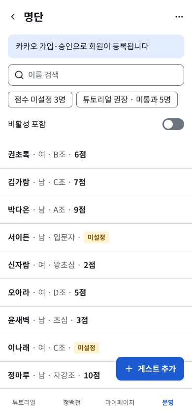
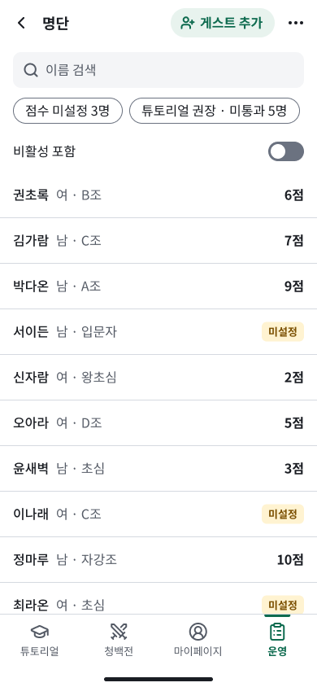
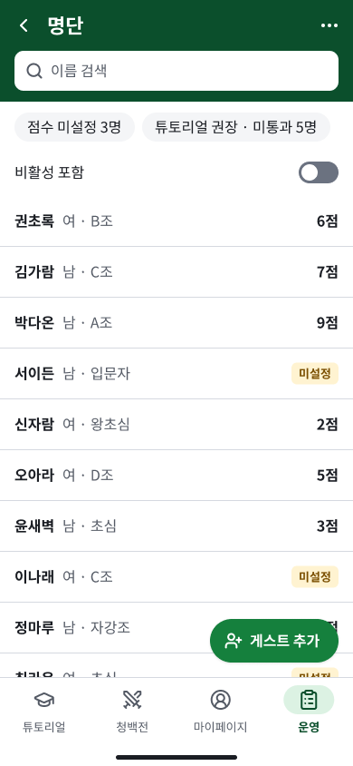

# SCR-211 명단 — 디자인 개선 실험 A/B (Figma-first, 2026-11-10)

- 목적: **ai-product-workflow 엔진의 디자인 생성·검토 과정 검증**. SMAPSH는 시험 프로젝트입니다.
- 상태: **실험 시안**. 승인 대상이 아니며 승인 문서(UX Planning r2, UX Spec r1)와 토큰(`tokens.json`)에 반영하지 않았습니다.
- 사용자가 실험에 한해 허용한 변경 세 가지: (1) 카카오 안내 배너 제거, (2) '게스트 추가'를 목록 위에 두는 대안, (3) 브랜드 색을 초록 계열로 변경.
- 지킨 제한: 승인 문서 수정 없음, 원본 프레임 `3:2` 수정 없음, 엔진 수정 없음, Preview 시작 없음, 외부 스킬 설치 없음, commit·push 없음, A/B 외 화면 없음.

## 1. 준비와 원본 보존

### 1.1 원본 프레임 기록(읽기 전용 조사, `use_figma` #7)

| 노드 | 종류 | 이름 | 위치·크기 |
|---|---|---|---|
| `3:2` | FRAME | SCR-211 명단 / ST1 기본 / mobile | 0,0 · 390×844 |
| `3:3` | FRAME | Content | 0,6 · 390×1176 |
| `3:4` | INSTANCE | CMP-026 PageHeader | 0,0 · 390×56 |
| `3:22` | FRAME | Controls(안내·검색·칩·비활성 포함) | 0,56 · 390×224 |
| `3:43` | FRAME | Roster list | 0,280 · 390×896 |
| `3:103` | INSTANCE | CMP-025 AppNav | 0,788 · 390×56 |
| `3:112` | INSTANCE | CMP-001 Button('게스트 추가') | 236,724 · 138×48 |

- 프레임에 직접 연결된 변수(인스턴스 내부 제외): `color/action/primary`, `bg/page`, `bg/surface`, `border/default`, `border/strong`, `status/info/bg`, `text/primary`, `space/1–4`, `space/gutter/mobile`, `radius/sm`, `radius/md`.
- 원본이 따른 토큰 값: `tokens.json`(승인된 04)과 같습니다. 주 행동 색은 파랑 `#1D5BD0`입니다.
- 실험 후에도 원본 `3:2`와 그 하위 노드, 기존 컴포넌트(`2:*`), 기존 변수 컬렉션(`1:2–1:7`)은 바꾸지 않았습니다. 기존 Badge(`2:18`)와 Switch(`2:28`)는 **인스턴스로만** 썼습니다.

### 1.2 글꼴
- Pretendard: Figma에서 **사용할 수 없음**(사용 가능 스타일 0개, 2026-11-10 다시 확인).
- 대체 글꼴: **Noto Sans KR**. 사용할 수 있는 굵기: Thin, Light, DemiLight, Regular, Medium, Bold, Black.
  - A안은 Regular, Medium, Bold를 썼습니다.
  - B안은 Regular, Bold를 썼습니다.
- Preview와 구현에서는 VD-001(Pretendard)을 그대로 씁니다.

### 1.3 참고한 규칙
- **frontend-design** v1.1.1(설치된 플러그인): 이번 세션의 Skill 목록에 나오지 않아, 플러그인 캐시의 `SKILL.md`를 직접 읽고 절차를 그대로 따랐습니다(§3).
- **UI UX Pro Max**: 설치하지 않았습니다. 앞선 검토(`SCR-211-mobile-ux-review.md`, 커밋 `4f2dbb6`)의 규칙 번호만 인용합니다.

## 2. Figma 산출물

파일: https://www.figma.com/design/gqwivlIXG9u8WoPpHIQWdQ · 페이지 `운영 · 명단`(`1:74`)

| 구분 | 프레임 | 노드 | 위치 |
|---|---|---|---|
| 기존안 | `SCR-211 명단 / ST1 기본 / mobile` | `3:2` | x=0 |
| A안 | `SCR-211 명단 / ST1 기본(실험 A Clean & Minimal) / mobile` | `13:98` | x=520 |
| B안 | `SCR-211 명단 / ST1 기본(실험 B Modern Sporty) / mobile` | `13:256` | x=990 |

- 프레임 위(y=−48)에 구분 표시 글자 3개를 두었습니다(`13:412–414`): "기존안 · 원본 프레임 3:2 (수정하지 않음)", "A안 … (실험, 승인 대상 아님)", "B안 … (실험, 승인 대상 아님)".
- 실험 컴포넌트 15개는 y=1000 아래에 둡니다(A: x=520, B: x=990). 이름은 모두 `EXP-A/…`, `EXP-B/…`로 시작합니다.
  - A: PersonRow score set `12:109` / unset `12:114`, GroupHeader `12:120`, FilterChip `12:122`, SearchField `12:124`, AppNav `12:130`, PageHeader `12:243`
  - B: PersonRow `12:178` / `12:183`, GroupHeader `12:189`, FilterChip `12:191`, SearchField `12:193`, AppNav `12:199`, PageHeader band `12:263`, FAB `12:283`
- 실험 변수(테마 구조, §5): `exp/brand-primitive`(`12:91`), `exp/theme-A`(`12:97`), `exp/theme-B`(`12:98`)
- **위치 변경 이유**: 처음에는 새 페이지 `02 실험 · SCR-211 A/B`를 만들려 했으나 Starter 플랜이 **페이지 3개 제한**으로 거부했습니다. 거부된 호출은 아무것도 만들지 않았습니다. 그래서 같은 페이지의 원본 오른쪽에 두었습니다.

### 2.1 스크린샷(Figma `get_screenshot`, 390×844, 1배율)

| 기존안 | A안 Clean & Minimal | B안 Modern Sporty |
|---|---|---|
|  |  |  |

파일: `screens/SCR-211-ST1-original-3_2.png`, `screens/SCR-211-ST1-expA-13_98.png`, `screens/SCR-211-ST1-expB-13_256.png`

## 3. frontend-design 적용 기록

스킬 절차는 계획 → 브리프와 대조·수정 → 제작 → 자기 비평 순서입니다. 고정 규칙은 `frontend-design-brief.md` 3장을 그대로 지켰습니다. 이번 실험에서 사용자가 허용한 세 항목만 그 예외로 두었습니다.

### 3.1 계획

| 항목 | A안 Clean & Minimal | B안 Modern Sporty |
|---|---|---|
| 기본 색(4–6개) | 흰 `#FFFFFF`, 면 `#F4F5F7`, 본문 `#1A1D23`, 보조 `#545A65`, **소나무 초록 `#0E6B4F`**, 옅은 초록 `#E8F3EE` | 흰, 면, 본문, 보조, **잔디 초록 `#15803D`**, **짙은 초록 `#0B4F2C`**, 옅은 초록 `#DCF2E3` |
| 글꼴 | 한 가지(Noto Sans KR, 본래 Pretendard). 이름 Medium, 점수 Bold, 제목 18 Bold | 한 가지. 이름·점수 Bold, 제목 22 Bold(흰 글자) |
| 대담함을 둔 한 곳 | **오른쪽 정렬 점수 열**(체육관에서 세로로 훑어 읽기) | **짙은 초록 헤더 띠**(제목 + 검색을 브랜드 띠 안에) |
| 내비게이션 | 아이콘 24 + 글자 13, 현재 탭은 위쪽 3px 초록 막대 + 굵은 글자 + 초록 | 아이콘을 감싸는 56×32 둥근 표시(옅은 초록) + 굵은 글자 + 짙은 초록, 탭 높이 64 |
| '게스트 추가' | **목록 위(헤더 오른쪽)** 옅은 초록 버튼(허용된 대안) | 오른쪽 아래 떠 있는 둥근 초록 버튼(UXD-026 배치 유지) |
| 정렬 | 왼쪽 정렬, 점수만 오른쪽 | 같음 |

배치 스케치:
```
A안                          B안
┌ ← 명단   [+게스트 추가] ⋯ ┐ ┌█ ← 명단             ⋯ █┐
│ [ 이름 검색 (면 채움) ]   │ │█ [ 이름 검색 (흰칸) ] █│
│ (칩)(칩)                  │ ├────────────────────────┤
│ 비활성 포함          ( ) │ │ (칩)(칩)  비활성 포함 ( )│
│ 권초록 여 · B조      6점 │ │ 권초록 여 · B조      6점 │
│ …                        │ │ …        [+게스트 추가] │
│ 📘  ⚔  👤  [▔운영]       │ │ 📘  ⚔  👤  (운영)        │
└──────── 안전 영역 34 ────┘ └──────── 안전 영역 34 ────┘
```

### 3.2 진부한 기본값과 대조해 고친 점
- 행을 카드로 나누고 그림자를 다는 'SaaS 카드 키트'는 두 안 모두 쓰지 않았습니다. 행은 구분선으로만 나눕니다.
- 짙은 배경에 형광 초록 강조를 쓰는 기본값도 피했습니다. 초록은 이미 상태 색(성공)과 코트 색에 쓰이므로 무작정 밝게 쓰지 않았습니다. B안은 짙은 초록 띠로 '활동적'인 느낌을 냈습니다.
- 대문자 라벨, 장식용 화살표(→), 섹션 번호는 쓰지 않았습니다.
- 스킬이 진부하다고 본 가운뎃점 표기는 UXD-074 표기라 유지했습니다. 다만 점수를 오른쪽 열로 떼면서 점수 앞의 가운뎃점 하나는 없어졌습니다(§6에서 UX 변경 여부를 판단).

### 3.3 자기 비평(제작 후 스크린샷 기준)
- **A안**: 정돈되어 있지만 이름 Medium과 보조 정보 Regular의 굵기 차이가 작아, 기존안(이름 Bold)보다 이름이 덜 튑니다. 검색칸이 테두리 없이 회색 면만 있어 흰 배경과의 경계 대비가 1.09:1입니다.
- **B안**: 헤더 띠가 브랜드 인상을 강하게 만들지만, 떠 있는 버튼이 **오른쪽 점수 열을 직접 가립니다**. 스크린샷에서 '정마루 10점'이 가려졌습니다. 기존안에서는 360px의 긴 행에서만 생기던 가림이 390px의 모든 행으로 넓어졌습니다.
- 둘 다 하나를 더 뺀다면: A는 헤더 버튼의 옅은 초록 면, B는 칩의 회색 면입니다.

## 4. 비교

### 4.1 측정값과 추정값
**실측** = Figma 노드 크기를 실제로 읽은 값입니다(A/B: 호출 #10, 기존안: 이전 호출 #6). **추정** = 실측값으로 계산한 값입니다.

| 항목 | 기존안 | A안 | B안 | 구분 |
|---|---|---|---|---|
| 헤더 높이 | 56 | 56 | 112(띠: 헤더 56 + 검색 44 + 12) | 실측 |
| 컨트롤 영역 | 224(배너 포함) | 156 | 104(검색은 띠 안) | 실측 |
| 목록 시작 y | 280 | 212 | 216 | 실측 |
| 하단 메뉴 | 56(안전 영역 없음), y=788 | 56 + 안전 영역 34 = 90, y=754 | 64 + 34 = 98, y=746 | 실측(34는 iPhone **가정값**) |
| 첫 화면에 보이는 행 수(390) | 9.07(안전 영역 없음) / **8.5**(안전 영역 34 가정) | **9.68** | **9.46** | 행 높이·좌표는 실측, 행 수는 계산 |
| 360×800 행 수 | 7.1–7.6 | 약 8.2(칩 줄바꿈 +40 가정) | 약 8.0 | 추정 |
| 칩 줄 폭(390에서 쓸 수 있는 폭 358) | 345 | 353(135+8+210) | 349(133+8+208) | 실측 |
| 칩 줄 360(쓸 수 있는 폭 328) | 두 줄 | 두 줄 | 두 줄 | 추정 |
| 행 높이 / 행 사이 간격 | 56 / 0 | 56 / 0 | 56 / 0 | 실측 |
| 행 글자 오른쪽 끝 최대 | 222(점수 포함) | 144(점수 제외), 점수 열 x=322–374 | 같음 | 실측 |
| '게스트 추가' | 오른쪽 아래 138×48 (236,724) | 헤더 안 옅은 버튼(보이는 높이 36) | 오른쪽 아래 142×48 (232,682) | 실측 |
| 떠 있는 버튼과 행의 겹침(390) | 겹치지 않음(여유 14), 5글자 이름이면 겹침 | 해당 없음(떠 있는 버튼 없음) | **점수 열 x 322–374 전체가 버튼 x 232–374와 겹침** → 버튼 높이를 지나는 모든 행의 점수가 가려짐 | 실측 + 스크린샷 확인 |
| 목록 아래 스크롤 여백 | 136 | 106(= 16 + 90) | 178(= 16 + 98 + 48 + 16) | 실측(의도한 값) |
| 탭 크기 | 98×55 | 98×56 | 98×64 | 실측 |

### 4.2 평가

| 기준 | 기존안 | A안 | B안 |
|---|---|---|---|
| 디자인 완성도 | 기능 중심의 기본형. 브랜드 표현 없음, 탭 아이콘 없음 | 정돈됨. 초록은 '게스트 추가'·현재 탭에만 써서 절제됨. 점수 열이 정렬되어 훑어 읽기 좋음 | 브랜드 인상이 가장 강하고 앱다움. 헤더 띠와 탭 표시의 완성도가 높음 |
| 정보 밀도 | 8.5행(안전 영역 가정) | **9.68행**(가장 높음) | 9.46행 |
| 모바일 사용성 | 주 버튼이 엄지 영역. 360에서 긴 행 가림 | 주 버튼이 화면 위쪽이라 **한 손 엄지 영역 밖**(체육관 한 손 조작 요구와 충돌, 브리프 2장). 가림 없음 | 주 버튼이 엄지 영역. 대신 **점수 가림 결함**. 탭 높이 64로 누르기 쉬움 |
| 접근성(대비) | 통과 | 검색칸 경계 **1.09:1**(WCAG 1.4.11 위험). 그 밖은 통과(게스트 추가 글자 5.71, 현재 탭 6.49) | 칩 경계 **1.09:1**(위험), 탭 둥근 표시와 흰 배경 1.18(색 외에 굵은 글자로도 구분해서 통과). 제목 9.68, 버튼 글자 5.02 |
| 토큰 충돌 | 없음 | 옅은 초록 `#E8F3EE` ↔ `status.success.bg` 색차 **4.0**(거의 같음) | 잔디 초록 `#15803D` ↔ `status.success.fg` 색차 **9.6**, 옅은 초록 `#DCF2E3` ↔ success.bg **2.9** → 성공 상태와 브랜드가 구분되지 않음 |

요약: **밀도는 A**, **브랜드 표현과 모바일 앱다움은 B**가 낫습니다. A는 주 버튼이 엄지 영역 밖으로 갔고, B는 점수가 가려집니다. 두 문제 모두 '배치 결정(UXD-026)'과 직접 얽혀 있습니다.

## 5. 실험용 변경 목록(기존 토큰과 달라지는 값)

테마 구조:
- `exp/brand-primitive`: 원시 색 5개(`pine/50`, `pine/700`, `grass/100`, `grass/700`, `grass/900`)
- `exp/theme-A`, `exp/theme-B`: 같은 이름의 의미 변수 5개가 원시 색이나 기존 변수를 별칭으로 가리킴
- Starter 플랜이 **모드를 1개만 허용**해서, 한 컬렉션에 A/B 모드를 두지 못하고 테마마다 컬렉션을 따로 만들었습니다. `theme-separation.md`의 "테마 하나 = 파일 하나"와 같은 모양입니다.

| # | 항목 | 기존(승인 04·명세) | A안 | B안 | 토큰 범위 |
|---|---|---|---|---|---|
| X1 | 주 행동 색 | `action.primary` #1D5BD0 | `theme-A/action/primary` → #0E6B4F | `theme-B/action/primary` → #15803D | 테마 값 변경 |
| X2 | 옅은 강조 면(새 의미) | 없음 | `action/tint` → #E8F3EE | → #DCF2E3 | **새 의미 토큰** |
| X3 | 현재 탭 색(새 의미) | 04에 별도 토큰 없음(주 행동 색을 씀) | `nav/active` → #0E6B4F | → #0B4F2C | **새 의미 토큰** |
| X4 | 헤더 배경·글자(새 의미) | `bg.page` / `text.primary` | 같음(별칭) | `header/bg` #0B4F2C, `header/fg` 흰색 | **새 의미 토큰** |
| X5 | 포커스 링 | `focus.ring` #1D5BD0 | **바꾸지 않음(파랑 그대로)** | 같음 | 테마 누락 |
| X6 | 둥근 정도 | radius sm 6 / md 10 / sheet 16 | 칩 16, 헤더 버튼 18 | 칩 16, 탭 표시 16, 떠 있는 버튼 24 | 16은 sheet와 같은 값이지만 용도가 다름. 18·24는 **토큰 밖** |
| X7 | 글자 굵기 | regular 400 / bold 700 | 이름 **Medium 500** | 그대로 | **토큰 밖** |
| X8 | 하단 탭 높이 | CMP-025 '탭 높이 56' | 56 | **64** | 명세 값과 다름 |
| X9 | 안전 영역 | 정의 없음 | 34(가정) | 34(가정) | 새 값(VD-020 후보) |
| X10 | 헤더 버튼 높이 | CMP-001 md 44 / lg 48 | 보이는 높이 **36**(누름 영역 44 가정) | - | 명세 값과 다름 |
| X11 | 검색칸 | 테두리 `border.strong` | 테두리 없음, 면 `bg.surface` | 테두리 없음, 띠 위 흰 칸 | 같은 토큰, 표현 변경 |
| X12 | 필터 칩(꺼짐) | `border.strong` 테두리 | 같음 | 테두리 없음, 면 `bg.surface` | 같은 토큰, 표현 변경 |
| X13 | 제목 크기 | font.size.title 18(원본) | 18 | heading **22** | 토큰 안, 용도 변경 |
| X14 | 탭 아이콘 | 없음(글자만) | Lucide graduation-cap, swords, circle-user-round, clipboard-list | 같음 | VD-019 예정 항목 |

글자 스타일은 모두 기존 Figma 텍스트 스타일(`font/body` 등)에 연결했고, A안 이름(X7)만 직접 값입니다. 색은 모두 변수에 연결했습니다(직접 hex 값 0개).

## 6. 기존 UX 명세와 달라지는 부분과 분류

분류 기준은 `docs/workflow-proposals/engine-design-stages.md` P0입니다.
- ① 정보·행동(UX Spec)
- ② 토큰 의미·이름(UX Spec)
- ③ 테마 값(테마 게이트)
- ④ 시각 표현(VD)
- ⑤ 구현 메모

| # | 달라지는 부분 | 근거 문서 | 안 | 분류 | 자동 분류 신호 | 자동 분류 가능성 |
|---|---|---|---|---|---|---|
| D1 | 카카오 가입 안내 줄 제거 | 02 SCR-211 정보 4, UXD-014 | A·B | ① | 명세 정보 행에 대응하는 노드(CMP-023)가 없음 | **높음**(노드↔정보 행 대응이 있으면) |
| D2 | '게스트 추가'를 헤더(목록 위)로 이동 | UXD-026, 02 반응형 | A | ① | 주 버튼 위치가 '오른쪽 아래 떠 있음'에서 헤더로 바뀜 | 중간(배치 규칙을 기계가 읽을 수 있게 적어야 함) |
| D3 | '게스트 추가'를 둥근 버튼으로(위치 유지) | VD-012 | B | ④ | 같은 CMP, 같은 위치, 반경만 바뀜 | 높음 |
| D4 | 브랜드 초록 | 04 `action.primary` | A·B | ③(현재 엔진에서는 ②로 처리됨) | 의미 이름은 같고 값만 바뀜 | 높음 |
| D5 | 새 의미 색(옅은 강조, 현재 탭, 헤더 띠) | 04 1.2 | A·B | ② | 04에 없는 의미 변수 이름 | **높음**(이름 목록 대조) |
| D6 | 점수를 오른쪽 열로 분리 | UXD-074 표기 '김민수 · 남 · C조 · 7점', VD-007 | A·B | ④ 또는 ①(**판단 필요**) | 순서는 같고 구분자와 정렬이 바뀜 | **낮음**: 표기 규칙이 '보이는 글자'인지 '정보 순서'인지 명세가 정하지 않음 |
| D7 | 이름 굵기 Medium | VD-007 | A | ④ + 토큰 밖 | 토큰에 없는 굵기 | 높음 |
| D8 | 탭 높이 64 | 04 CMP-025 | B | ①? ④?(**판단 필요**) | 명세의 수치와 다름 | 중간: 04 CMP의 수치가 '최솟값'인지 '고정값'인지 명세에 없음 |
| D9 | 탭 아이콘 추가 | 04 CMP-025(아이콘 언급 없음) | A·B | ④(VD-019) | 새 하위 노드, 정보 의미 없음 | 중간 |
| D10 | 헤더 띠 안에 검색 | 02 레이아웃(검색은 안내 아래) | B | ④ | 정보 순서는 같고 묶는 영역만 바뀜 | 중간 |
| D11 | 헤더 버튼 보이는 높이 36 | CMP-001 크기 md/lg | A | ④ + 명세 값 위반 | 크기 목록에 없음 | 높음 |
| D12 | 검색칸·칩 테두리 제거 | VD-010·011 | A·B | ④(접근성 위험) | 경계 대비 계산 | 높음(계산 가능) |
| D13 | 안전 영역 34 | 정의 없음 | A·B | ④(VD-020 후보) + ⑤ | 새 영역 | 높음 |
| D14 | 포커스 링이 파랑으로 남음 | 04 `focus.ring` | A·B | ③ 누락 | 테마가 바뀌었는데 같은 계열 토큰이 이전 값 | 높음(테마 검사로 탐지) |
| D15 | 떠 있는 버튼이 점수 열을 가림 | UXD-026 + D6의 결합 | B | 결함(D6 때문에 생김) | 고정 요소와 행 내용의 기하 계산 | 높음(계산), 원인 판단은 사람 |

결론:
- 15개 중 **9개는 기계적으로 분류할 수 있습니다**(D1, D3, D4, D5, D7, D11, D12, D13, D14).
- 4개는 조건부입니다(D2, D8, D9, D10). 명세의 배치 규칙과 수치가 '최솟값인지 고정값인지'를 정해 두어야 합니다.
- 1개(D6)는 명세 자체의 해석이 필요합니다.
- D15는 결함이라 분류 대상이 아닙니다. 탐지는 계산으로 되지만 원인 판단은 사람이 합니다.

## 7. 엔진 관점 검증

### 7.1 Design Direction 단계의 필수 입력과 출력
- **확인된 입력**(제안서 §3과 같음): 승인된 UX Spec과 해시, 토큰, 디자인 프로필, 밀도 정책, 브리프, 비식별 샘플 데이터
- **새로 필요하다고 확인된 입력**
  1. **실험 허용 목록**: 이번 세 가지처럼 승인 명세와 달라져도 되는 항목을 명시해야 합니다. 이것이 없으면 D1, D2가 '위반'인지 '허용된 실험'인지 구분할 수 없습니다.
  2. **보존 대상 목록**: 원본 프레임 노드 ID, 기존 컴포넌트, 기존 변수 컬렉션
  3. **도구·플랜 제약**: 페이지 3개, 변수 모드 1개, 월 호출 한도. 제약 때문에 실제 구조가 바뀌었습니다(새 페이지 → 같은 페이지, 모드 → 컬렉션 2개).
  4. **비교 기준 프레임과 측정 기준**: 같은 기기 높이, 안전 영역 가정값. 기존안에 안전 영역이 없어 행 수 비교에 가정이 들어갔습니다.
- **확인된 출력**
  - 안별 계획(색, 글꼴, 대담함 한 곳, 배치 스케치)
  - 실험용 변경 표(§5)
  - 명세 차이와 분류 표(§6)
  - 프레임·컴포넌트·변수 ID 목록
  - 저장소 안의 스크린샷

### 7.2 frontend-design 스킬의 실제 기여
| 기여한 것 | 기여하지 않은 것 |
|---|---|
| 순서를 강제함(계획 → 진부한 기본값과 대조 → 제작 → 스크린샷 자기 비평). 이 순서 덕에 B안의 점수 가림을 '개선'이 아니라 '결함'으로 바로 기록함 | 구체적인 값(색, 치수)은 거의 주지 않음. 값은 승인 토큰과 대비 계산에서 나옴 |
| "대담함은 한 곳에만": A는 점수 열, B는 헤더 띠로 안마다 강조 위치가 분명해짐 | 모바일 규칙(안전 영역, 엄지 영역, 터치 크기)과 업무 화면 밀도 기준이 없음. 이것은 UI UX Pro Max 규칙과 밀도 정책이 메움 |
| 카드 키트, 대문자 라벨, 화살표를 피하게 함 | HTML 제작이 전제라 Figma 제작 절차와 연결되지 않음(Figma 지침은 별도 스킬) |
| 글쓰기 지침(행동 이름 일관): '게스트 추가'를 버튼·명세 문구와 같게 유지 | 가운뎃점 표기를 진부하다고 보는 지침이 UXD-074와 충돌해, 명세 해석 문제(D6)를 만듦 |

판단: frontend-design은 **과정의 규율**(계획·대조·비평)로는 쓸모가 있습니다. 값을 정하는 근거로는 약합니다. 엔진에서는 "Design Direction의 계획·자기 비평 형식"으로 쓰고, 값의 근거는 토큰·테마·규칙 출처에 두는 것이 맞습니다.
- 이번 세션에서 이 스킬은 Skill 도구로 호출되지 않았고, `SKILL.md`를 직접 읽어 적용했습니다. 엔진은 스킬이 '실제로 호출되었는지'가 아니라 '형식대로 결과물이 남았는지'로 확인해야 합니다.

### 7.3 Visual Review에서 필요한 품질 기준
이번 실험에서 실제로 문제를 잡은 기준과, 잡아야 했던 기준입니다.
1. **고정 요소 × 스크롤 위치 겹침**: 첫 화면 스크린샷만으로는 모자랍니다. 행의 모든 스크롤 위치에서 고정 요소(떠 있는 버튼, 하단 탭)와 행 안 정보(점수, 배지)의 x 범위가 겹치는지 계산해야 합니다(D15).
2. **경계 대비(WCAG 1.4.11)**: 입력칸·칩처럼 누를 수 있는 요소의 경계가 배경과 3:1 이상인지 봅니다(D12).
3. **테마 누락 검사**: 브랜드가 바뀌었는데 같은 계열의 의미 토큰(포커스 링 등)이 이전 값으로 남았는지 봅니다(D14).
4. **상태 색 구분**: 브랜드 색과 성공 상태 색의 색차 기준을 둡니다(예: 색차 20 미만이면 경고). 이번 결과는 A 17, B 9.6이고, 옅은 면은 2.9–4.0이었습니다.
5. **엄지 영역**: 주 행동이 화면 아래쪽 1/3 안에 있는지 봅니다(A 결함 후보).
6. **밀도 수치**: 첫 화면 행 수를 기준 대비로 보고, 측정값과 가정값(안전 영역)을 분리해 적습니다.
7. **토큰 연결률**: 직접 값을 쓴 노드 수와 '토큰 밖 값'을 목록으로 냅니다(X6, X7).
8. **글꼴 대체 표시**: 프레임에 쓴 글꼴과 프로젝트 글꼴이 다르면 결과 문서에 반드시 적습니다.
9. **아이콘 출처 검증**: Lucide 도형을 손으로 옮겨 적었으므로, 패키지 원본과 대조하기 전까지는 '미검증'으로 둡니다.

### 7.4 디자인 변경과 UX 변경의 자동 분류 가능성
- §6 기준으로 **약 60%는 자동 분류가 가능**합니다(15개 중 9개).
- 그러려면 세 가지가 전제되어야 합니다.
  - (1) Figma 노드가 명세 ID(CMP, 정보 행)를 이름에 가지고 있어야 합니다.
  - (2) 색·크기가 변수에 연결되어 있어야 합니다.
  - (3) 배치 규칙(UXD-026 같은 것)과 수치의 성격(최솟값인지 고정값인지)이 기계가 읽을 수 있는 형식이어야 합니다.
- 나머지는 명세 해석(D6), 수치 성격(D8)처럼 **명세 작성 규칙을 보강하면 줄일 수 있는 것**입니다.
- 엔진 개선 후보 추가: UX Spec 작성 규칙에 "표기 규칙은 정보 순서인지, 보이는 문자열인지 명시", "CMP 수치는 min/fixed 표기"를 넣는 것.

### 7.5 Figma-first 결과물의 재현 가능성
| 항목 | 현재 | 재현성 |
|---|---|---|
| 생성 스크립트 | `use_figma` 호출 코드가 대화 기록에만 있음 | **낮음**: 저장소에 스크립트를 남겨야 다시 만들 수 있음 |
| 노드 ID | 파일마다 다름 | 같은 파일에서만 유효. 다시 만들면 ID가 바뀜 |
| 플랜 제약 | Starter: 페이지 3, 모드 1, 월 호출 한도 | 플랜이 바뀌면 같은 스크립트가 다른 구조(모드 사용)를 만듦 → 결과 문서에 환경을 기록해야 함 |
| 글꼴 | Pretendard 없음 → Noto Sans KR | 사용자 PC 글꼴에 따라 결과가 달라짐 |
| 스크린샷 | `get_screenshot` URL은 짧은 시간만 유효 | 저장소로 내려받아 두었으므로 재현 가능(`screens/`) |
| Figma 버전 고정 | 버전 ID를 읽지 않음 | 검토 시점을 고정할 수 없음. 제안서 §4의 '버전 ID 기록'을 실행할 수단이 MCP에 있는지 확인 필요 |
| 원천 데이터 | 샘플 데이터·토큰은 저장소에 있음 | 높음 |

판단: Figma-first는 **탐색에는 유효하지만, 그대로는 재현 가능한 산출물이 아닙니다**. 엔진에서 Figma-first 경로를 쓰려면 다음 세 가지를 Visual Review 입력의 필수 조건으로 두어야 합니다.
1. 생성 스크립트를 저장소에 남깁니다(예: `docs/design-profile/figma-scripts/`).
2. 스크린샷을 저장소에 둡니다.
3. 환경(플랜, 글꼴, 호출 수)을 기록합니다.

## 8. 사용자 평가 요청 항목

1. 방향: A(절제), B(적극), 또는 둘을 섞은 안(예: B의 헤더 띠·탭 + A의 '게스트 추가' 처리) 중 무엇으로 갈지
2. '게스트 추가' 위치: 목록 위(A, 밀도↑, 엄지 영역 밖) / 오른쪽 아래 유지(B, 점수 가림 해결 필요)
3. 점수 오른쪽 열(D6): UXD-074 표기의 허용 범위 안으로 볼지, UX Spec 개정 사항으로 볼지
4. 초록 브랜드와 성공 상태 색의 충돌: 성공 색을 다른 계열로 옮길지, 브랜드를 청록 쪽(A의 소나무 초록)으로 둘지

평가 결과는 VD 후보 또는 UX Spec 개정 후보로만 기록하고, 승인 문서에는 사용자 승인 전까지 반영하지 않습니다.
