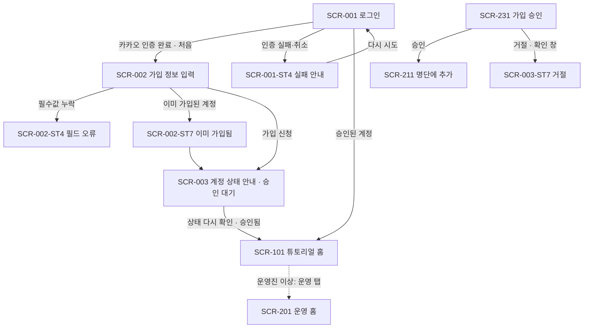
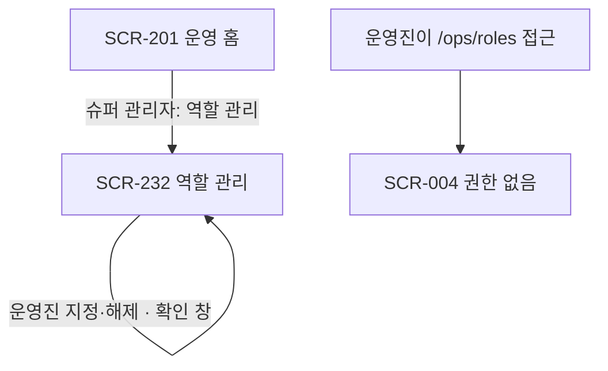
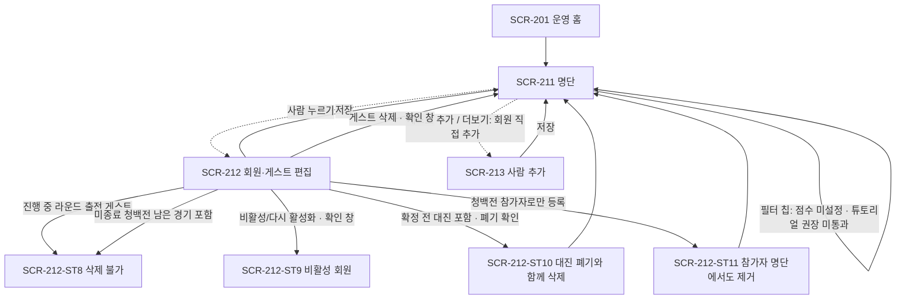
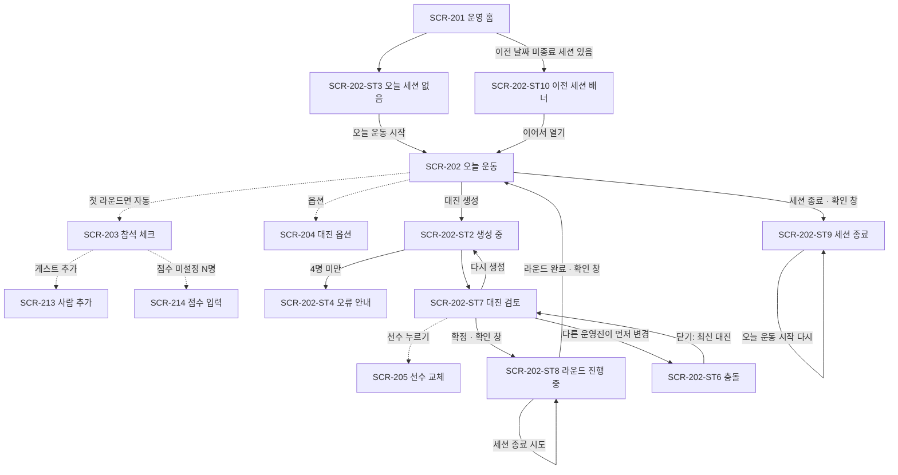
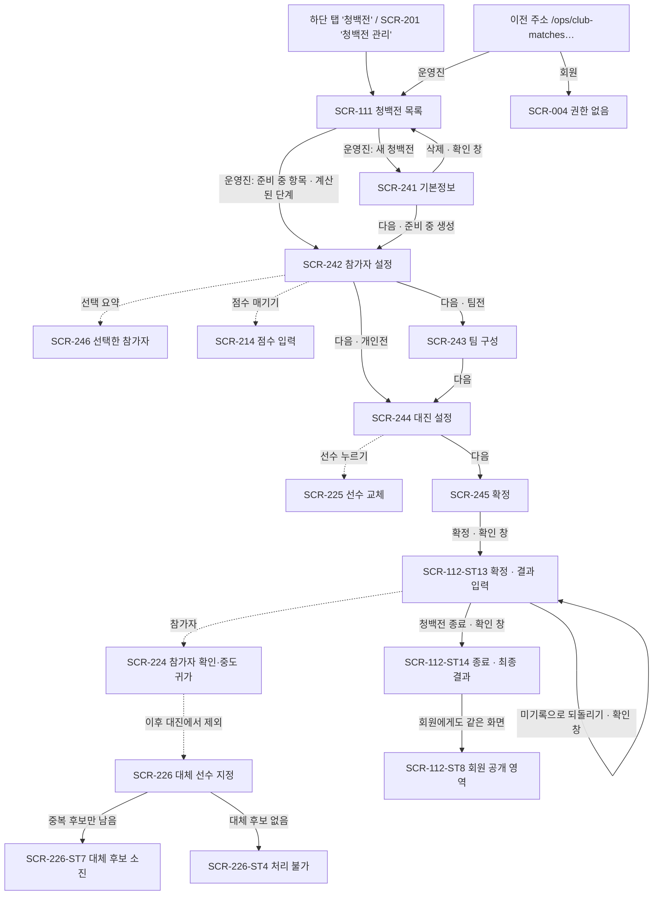
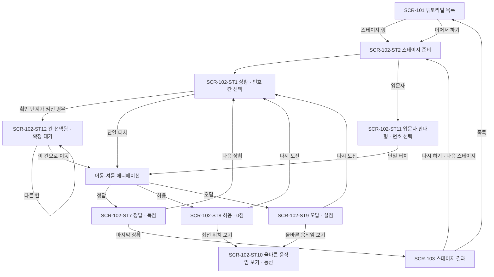
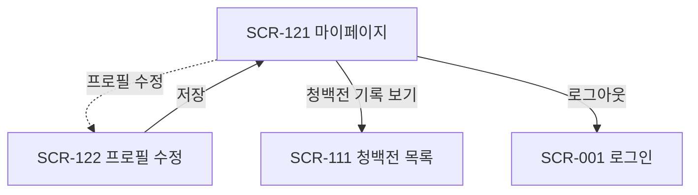

# 화면 이동 흐름 (Screen Flows): 배드민턴 플레이북 (badminton-playbook)

기획의 User Flow(`04-user-flows.md`, r6)를 화면 단위로 옮깁니다. 기획의 FLOW 단계 84개((r3) 88개, 아래 r3 개정 참조)(대안·오류 경로 포함)를 모두 아래 대응표에 둡니다. (r4) FLOW-004-S1a·S9a·S9b, FLOW-003-S5b·S5c·S5d를 추가하고 FLOW-004-S9를 갱신했습니다.

> **r6 개정(2026-11-20)**: UX Planning r7(UXD-085–089)에 따라 청백전 운영 흐름(FLOW-005)을 회원·운영진 공통 화면 SCR-111·SCR-112로 옮겼습니다. 상태 번호 대응: 운영 상세 ST1→SCR-112-ST10, ST2→ST11, ST3→ST9, ST4→ST4, ST6→ST6, ST7→ST12, ST8→ST13, ST9→ST14 / 관리 목록 ST1→SCR-111-ST1, ST3→SCR-111-ST7. 기획 FLOW 단계와 대응 범위는 바뀌지 않았고, 이전 주소(`/ops/club-matches…`)는 운영진에게 새 주소로, 회원에게 SCR-004로 갑니다.

> **r2 개정(2026-11-13)**: Planning r5에서 생긴 FLOW-005-S4c·S7a·S7b, FLOW-008-S3a를 02 r2의 화면 상태(SCR-223-ST8, SCR-226-ST7·ST4, SCR-112-ST8)에 대응시켰습니다(변경안 X12). 사용자 결정 D2에 따라 '패널'을 '시트'로 바꿨습니다(PC·모바일 공통 하단 시트). 화면 29개·라우트·기존 FLOW 대응은 바뀌지 않았습니다.
> **r3 개정(2026-11-18)**: Planning r7의 FLOW-006 개정(S1·S2·S3·S4·S6·S1b)과 새 단계 FLOW-006-S1c·S3a·S3b·S6b를 02 r3의 화면 상태에 대응시켰습니다. FLOW-003-S7 비고를 새 난이도 기준으로 고쳤습니다. 다른 FLOW와 화면 이동은 바뀌지 않았습니다. 대응하는 FLOW 단계는 88개입니다(84 + 4).

상태 ID는 `01` 6.2의 고정 번호(ST1 기본, ST2 로딩, ST3 빈 상태, ST4 오류, ST5 권한 없음, ST6 충돌, ST7– 고유 상태)와 `02`의 화면별 상태 정의를 따릅니다.
시트는 부모 화면 위에 열리므로 흐름도에서 점선(`-.->`)으로 표시합니다.

> **r5 개정(2026-11-19)**: UX 결정 r6(UXD-077 개정)에 따라 FLOW-006-S2의 번호 격자 표시 시점(셔틀이 멈춘 뒤, 입문자는 처음부터)을 명확히 했습니다. 흐름 단계·화면·상태 매핑은 바뀌지 않았습니다.

> **r8 개정(2026-11-24)**: Planning r9·UX Planning r8에 따라 FLOW-005의 생성 구간을 청백전 생성 페이지(SCR-241–246)로 옮겼습니다. 새 단계 FLOW-005-S9·S10과 대안 경로 S1a·S1b·S1c·S2c·S2d·S2e·S3e·S3f·S9a를 대응시켰고, SCR-222·SCR-112-ST9–ST12·SCR-224의 준비 중 상태를 가리키던 대응을 새 화면으로 바꿨습니다. FLOW-003-S5d의 참가자 명단은 SCR-242로 옮겼습니다. 확정 이후 단계와 다른 FLOW는 바뀌지 않았습니다(FLOW 단계 99개).

> **r9 개정(2026-11-24)**: Planning r10의 FLOW-005-S9 보강과 새 대안 경로 FLOW-005-S9b(팀 구성 방식)를 SCR-243 상태에 대응시켰습니다. 다른 대응은 바뀌지 않았습니다(FLOW 단계 100개).

## FLOW-001: 가입 신청 → 승인 → 로그인



### FLOW 단계 → 화면 대응

| FLOW 단계 | 화면·상태 | 비고 |
|---|---|---|
| FLOW-001-S1 | SCR-001-ST1, SCR-001-ST2, SCR-002-ST1, SCR-002-ST2 | 카카오 인증 → 가입 정보 입력(급수 8개 버튼, 지인 선택) → 제출 |
| FLOW-001-S2 | SCR-201-ST1, SCR-231-ST1 | 운영 홈 '가입 승인'(대기 건수 배지) → 신청 순서 목록(이름·성별·급수·지인) |
| FLOW-001-S3 | SCR-231-ST1 | 개별 '승인' 또는 체크 후 일괄 승인. 승인된 회원은 SCR-211에 점수 미설정으로 나타남 |
| FLOW-001-S4 | SCR-001-ST2, SCR-101-ST1 | 역할 확인 후 튜토리얼 홈(회원 홈). 운영진 이상은 하단 '운영' 탭이 함께 보임 |
| FLOW-001-S1a | SCR-002-ST4 | 이름·성별·급수 중 빈 항목 아래 오류. 지인은 비워도 됨 |
| FLOW-001-S1b | SCR-002-ST7, SCR-003-ST1, SCR-101-ST1 | 새 계정을 만들지 않고 기존 계정 상태에 맞는 화면으로 이동 |
| FLOW-001-S1c | SCR-001-ST4 | 실패 안내 상자와 '다시 시도'. 2회 이상 실패 시 다른 브라우저 안내(UXD-019) |
| FLOW-001-S3a | SCR-231-ST1, SCR-003-ST7 | 한 명씩 확인 창을 거쳐 거절. 거절된 계정은 로그인하면 거절 안내 |
| FLOW-001-S4a | SCR-003-ST1, SCR-003-ST7, SCR-003-ST8 | 승인 대기·거절·비활성 안내와 '상태 다시 확인'·로그아웃 |

## FLOW-002: 운영진 지정과 해제



### FLOW 단계 → 화면 대응

| FLOW 단계 | 화면·상태 | 비고 |
|---|---|---|
| FLOW-002-S1 | SCR-201-ST1, SCR-232-ST1, SCR-232-ST2 | 슈퍼 관리자에게만 메뉴가 보임. 역할별 묶음 목록과 이름 검색 |
| FLOW-002-S2 | SCR-232-ST1, SCR-232-ST4 | 행의 '운영진 지정'·'운영진 해제' → 확인 창 → 결과 반영. 실패 시 오류 문구 |
| FLOW-002-S1a | SCR-232-ST5, SCR-004-ST1 | 운영진에게는 메뉴를 숨기고, 주소로 들어오면 권한 없음. 서버도 거부 |

## FLOW-003: 회원 명단, 게스트, 점수 관리



### FLOW 단계 → 화면 대응

| FLOW 단계 | 화면·상태 | 비고 |
|---|---|---|
| FLOW-003-S1 | SCR-211-ST1, SCR-211-ST2, SCR-211-ST3 | 회원(이름순)·게스트 구분, 행에 이름·성별·급수·점수(UXD-074) |
| FLOW-003-S2 | SCR-213-ST7, SCR-212-ST1 | 회원 직접 추가(더보기, 예외 경로)와 기존 회원 수정(급수 포함) |
| FLOW-003-S3 | SCR-213-ST1 | 게스트 추가: 이름·성별·급수·점수. 게스트는 랭크 대상 아님 |
| FLOW-003-S4 | SCR-212-ST1, SCR-212-ST7 | 1–10 숫자 버튼(5개씩 두 줄). 참석·참가 중에는 SCR-214에서도 매김(FLOW-005-S2b) |
| FLOW-003-S5 | SCR-212-ST7, SCR-211-ST1 | 시트 아래쪽 '게스트 삭제' → 확인 창 → 명단에서 사라지고 지난 기록은 '삭제된 게스트' |
| FLOW-003-S6 | SCR-212-ST1, SCR-212-ST9, SCR-211-ST1 | 비활성 처리·다시 활성화(확인 창). 명단은 '비활성 포함' 토글로 비활성 회원을 보여 줌(UXD-024) |
| FLOW-003-S7 | SCR-211-ST1, SCR-212-ST1, SCR-212-ST7 | '튜토리얼 권장 · 미통과 N명' 칩(UXD-073) → 행 → 편집 시트에서 급수·지인·랭크·전적·튜토리얼 현황((r3) 새 난이도별 입문자 n/2·왕초급 n/3·초급 n/3, 개편 전 기록 제외). 게스트는 현황 없음 |
| FLOW-003-S2a | SCR-212-ST4, SCR-213-ST4 | 급수를 고르지 않으면 저장하지 않고 필드 아래 오류 |
| FLOW-003-S4a | SCR-212-ST4, SCR-214-ST4 | 버튼 입력이라 범위 밖 값은 화면에서 만들 수 없음. 서버 거부 시 오류 문구 |
| FLOW-003-S5a | SCR-212-ST8 | 삭제 버튼 비활성과 '라운드가 끝난 뒤 삭제하세요' 안내 |
| FLOW-003-S5b | SCR-212-ST8, SCR-112-ST13 | (r4) 청백전 이름과 남은 경기 수 안내, '청백전으로'에서 대체 선수 지정(SCR-224·SCR-226) 후 삭제 |
| FLOW-003-S5c | SCR-212-ST10 | (r4) 확정 전 대진(실시간·청백전) 폐기 확인 창 → 폐기와 삭제를 한 번에, 실패하면 둘 다 그대로 |
| FLOW-003-S5d | SCR-212-ST11, SCR-242-ST1 | (r4) 참가자 명단 제거를 함께 안내하고 한 번에 처리, 실패하면 둘 다 그대로 |

## FLOW-004: 운동 당일 실시간 대진 (핵심 플로우)



### FLOW 단계 → 화면 대응

| FLOW 단계 | 화면·상태 | 비고 |
|---|---|---|
| FLOW-004-S1 | SCR-202-ST3, SCR-202-ST1 | '오늘 운동 시작' → 세션 생성, 첫 라운드면 참석 시트 자동 열림(UXD-002) |
| FLOW-004-S1a | SCR-202-ST1, SCR-202-ST9, SCR-202-ST10 | (r4) 오늘 세션이 있으면 그 세션을 엶, 종료됐으면 새로 만들 수 없음 안내, 이전 날짜 미종료 세션은 배너로 이어서 열기·종료(UXD-076) |
| FLOW-004-S2 | SCR-203-ST1, SCR-213-ST1 | 참석 인원·성별 분포 고정 표시. 참석 시트에서 추가한 게스트는 바로 참석 체크(UXD-027) |
| FLOW-004-S3 | SCR-204-ST1 | 생성 방식 하나 + 규칙 4개. 다음 라운드 기본값 유지 |
| FLOW-004-S4 | SCR-202-ST2, SCR-202-ST7 | 코트 카드(1팀/2팀, 점수, 팀 점수 합, 실력차), 대기자, 완화 표시. 점수 미설정이 있으면 생성 버튼 비활성(UXD-023) |
| FLOW-004-S5 | SCR-202-ST7, SCR-205-ST1 | '다시 생성'(Must), 선수 맞바꾸기(Should, 대상별 교체 후 예상 실력차) |
| FLOW-004-S6 | SCR-202-ST7, SCR-202-ST8 | '확정' → 확인 창 → 진행 중. 확정 후에도 실력차 표시 |
| FLOW-004-S7 | SCR-202-ST8, SCR-202-ST1 | '라운드 완료' → 확인 창 → 지난 라운드 목록(접힘)에 쌓이고 다음 라운드 준비 |
| FLOW-004-S8 | SCR-203-ST1, SCR-202-ST1 | 참석 추가·제외 후 다시 생성. 직전 라운드 대기자 우선 |
| FLOW-004-S9 | SCR-202-ST1, SCR-202-ST9 | '세션 종료' → 확인 창(복구 불가·오늘 새 세션 불가 안내) → 생성·재개 버튼 없음 |
| FLOW-004-S9a | SCR-202-ST8, SCR-202-ST4 | (r4) 진행 중 라운드가 있으면 종료 비활성 + "진행 중인 라운드를 먼저 완료하세요", 서버 거부 시 오류 |
| FLOW-004-S9b | SCR-202-ST7, SCR-202-ST9 | (r4) 확정 전 대진만 있으면 확인 창에 대진 폐기 안내 → 폐기 후 종료 |
| FLOW-004-S4a | SCR-202-ST4 | "최소 4명이 필요합니다" 안내, 생성하지 않음 |
| FLOW-004-S4b | SCR-202-ST7 | 채울 수 있는 코트만 경기 카드, 나머지는 대기자 섹션 |
| FLOW-004-S4c | SCR-202-ST7 | 상단 한 줄 완화 요약 + 코트 카드 배지(누르면 설명), '성별 규칙 완화'(UXD-007) |
| FLOW-004-S6a | SCR-202-ST6 | 충돌 확인 창("확정은 처리되지 않았습니다") → 닫으면 최신 대진(UXD-010) |
| FLOW-004-S8a | SCR-203-ST1, SCR-202-ST8 | 진행 중 경기는 그대로, 다음 라운드부터 빠짐 |

## FLOW-005: 청백전 운영과 결과 반영 (r3, r6 공통 화면)



- (r6) 청백전 운영은 회원·운영진 공통 화면(SCR-111·SCR-112)에서 합니다(UXD-085). 폐기한 청백전 관리 목록·운영 상세의 상태는 SCR-111·SCR-112 상태로 옮겼습니다(02 SCR-112 '통합 매핑' 표).

### FLOW 단계 → 화면 대응

| FLOW 단계 | 화면·상태 | 비고 |
|---|---|---|
| FLOW-005-S1 | SCR-111-ST1, SCR-111-ST7, SCR-241-ST1, SCR-241-ST7, SCR-241-ST2 | (r8) 운영진 '새 청백전' → 생성 페이지 기본정보(UXD-090·092). 방식을 고르면 단계 수 결정(UXD-091), '다음'에서 준비 중 생성 |
| FLOW-005-S2 | SCR-242-ST1, SCR-242-ST8, SCR-246-ST1 | (r8) 참가 여부만 선택. 검색·필터·일괄 선택, 선택 요약 → 다음에서 일괄 저장(UXD-093) |
| FLOW-005-S3 | SCR-244-ST1, SCR-244-ST2, SCR-244-ST7, SCR-225-ST1 | (r8) 대진 설정 단계: 설정 → 생성(설정과 함께 저장) → 요약·사람별 경기 수·미리보기 → 다시 생성·교체(UXD-096) |
| FLOW-005-S6 | SCR-245-ST8, SCR-112-ST13 | (r8) 확정 단계의 '확정' → 확인 창 → SCR-112 확정 이후 화면 |
| FLOW-005-S4 | SCR-112-ST13 | 팀전 '청 승/백 승', 개인전 '승'. 순위 요약 카드·팀 승수 즉시 갱신 |
| FLOW-005-S7 | SCR-224-ST8, SCR-226-ST1 | '이후 대진에서 제외'('귀가' 표시) → 남은 경기마다 대체 선수(경기 수 적은 순) → 회원 화면 수정 표시 |
| FLOW-005-S8 | SCR-112-ST13, SCR-112-ST14 | '청백전 종료' → 확인 창 → 최종 결과 카드(UXD-072) |
| FLOW-005-S5 | SCR-112-ST1, SCR-112-ST8, SCR-121-ST1 | 회원은 청백전 상세에서 대진·결과·순위/팀 승수, 마이페이지에서 랭크·전적 |
| FLOW-005-S2a | SCR-242-ST1, SCR-243-ST1 | (r8) 게스트도 선택·팀 배정. 목록에 게스트 구분 |
| FLOW-005-S2b | SCR-242-ST7, SCR-214-ST1 | (r8) 점수 미설정 참가자 → 단계 안에서 점수 입력, 다음 비활성 |
| FLOW-005-S3a | SCR-225-ST1, SCR-244-ST7 | 같은 4명·같은 팀 구성, 팀전 청 2 대 백 2 위반이 되는 교체 대상은 비활성과 사유 |
| FLOW-005-S3b | SCR-244-ST9 | (r8) 분포 미리보기 아래 균등안·'입력값 유지'(UXD-071) |
| FLOW-005-S3c | SCR-241-ST9, SCR-243-ST11 | (r8) 방식 변경 확인(대진 폐기·팀 초기화·참가자 유지), 팀 변경은 대진 폐기 확인(자동 재생성 없음, UXD-098) |
| FLOW-005-S3d | SCR-225-ST1 | 경기 수 차이 2 이상이 되는 교체는 경고만 하고 허용. 개별 경기 추가·삭제 없음 |
| FLOW-005-S6a | SCR-112-ST6, SCR-225-ST6, SCR-226-ST6, SCR-241-ST6, SCR-242-ST6, SCR-243-ST6, SCR-244-ST6, SCR-245-ST6 | (r8) 생성 단계 저장·확정 포함, 충돌 → 처리하지 않고 확인 창 → 최신 상태·단계 재판정 |
| FLOW-005-S6b | SCR-112-ST13, SCR-225-ST1, SCR-224-ST8 | 확정 후에는 결과 없는 경기의 선수 교체만. 팀 변경 잠금 |
| FLOW-005-S4a | SCR-112-ST13, SCR-112-ST14 | 기록된 결과를 반대로 바꿀 때만 확인 창. 종료 후에도 수정하면 최종 결과 카드 재계산 |
| FLOW-005-S4b | SCR-244-ST7 | (r8) 확정 전 대진 미리보기에는 결과 버튼 없음 |
| FLOW-005-S8a | SCR-112-ST4 | 종료 버튼 비활성과 '결과 미기록 n경기' 안내(누르면 해당 경기로 이동) |
| FLOW-005-S8b | SCR-112-ST14, SCR-112-ST8 | 팀 승수가 같으면 '무승부 (5 : 5)'. 결정전 없음 |
| FLOW-005-S4c | SCR-112-ST13 | (r2, X12) 기록된 경기의 '미기록으로 되돌리기' → 확인 창 → 결과 삭제, 순위·팀 승수·랭크 재계산, 토스트. ST9(종료)에는 없음(AC-109, C-20, UXD-032·036) |
| FLOW-005-S7a | SCR-226-ST7 | (r2, X12) 중복되지 않는 대체 후보가 모두 소진되면 '대체 후보 소진' 안내와 함께 같은 4명·같은 팀 구성이 되는 후보만 선택 가능. 반영한 경기에 완화 사유 '대체 후보 소진'(AC-108, C-19, NFR-003, UXD-007·048) |
| FLOW-005-S7b | SCR-226-ST4 | (r2, X12) 유효한 대체 후보가 없는 경기가 있으면 '처리할 수 없습니다(n경기)' 안내와 '반영' 비활성. 제외도 대체도 반영하지 않음(AC-108, C-19) |
| FLOW-005-S9 | SCR-243-ST7, SCR-243-ST1 | (r8) 팀 구성 단계: 첫 진입 자동 배정안, 누르면 반대 팀, 되돌리기, 자동 재배정, 다음에서 일괄 저장(UXD-095). (r9) 방식 '자동 배정'(첫 진입 기본)·'직접 구성', 저장된 배정 복원 |
| FLOW-005-S9b | SCR-243-ST13, SCR-243-ST14, SCR-243-ST12 | (r9) '직접 구성' → 확인 → 모두 미배정 → 사람마다 청·백. '자동 배정' 다시 → 확인 → 배정안. 방식 저장 안 함(AC-135) |
| FLOW-005-S10 | SCR-245-ST1, SCR-245-ST7 | (r8) 확정 단계: 단계별 요약·검증 목록·'수정'(UXD-097) |
| FLOW-005-S1a | SCR-241-ST4 | (r8) 필수 항목·이름 30자 오류는 칸 아래 문구(AC-123) |
| FLOW-005-S1b | SCR-241-ST8, SCR-242-ST2, SCR-242-ST9 | (r8) 준비 중 재진입 → 계산된 단계, 저장하지 않은 변경 이탈 확인(UXD-099) |
| FLOW-005-S1c | SCR-241-ST10 | (r8) 준비 중 청백전 삭제 확인 → 목록 |
| FLOW-005-S2c | SCR-242-ST1, SCR-242-ST3, SCR-246-ST1, SCR-246-ST3 | (r8) 검색·필터(선택 유지)·현재 결과 일괄 선택·선택한 참가자 시트·빈 상태 |
| FLOW-005-S2d | SCR-242-ST7, SCR-214-ST1 | (r8) 점수 미설정 → 단계 안 점수 입력, 명단 점수 저장 안내 |
| FLOW-005-S2e | SCR-243-ST8 | (r8) 팀 구성 뒤 추가된 참가자는 미배정, 기존 배정 유지 |
| FLOW-005-S3e | SCR-242-ST10, SCR-243-ST11, SCR-244-ST8, SCR-241-ST9 | (r8) 대진이 있을 때 입력 변경 → 폐기 확인, 취소하면 원래 값(UXD-098) |
| FLOW-005-S3f | SCR-241-ST4, SCR-242-ST4, SCR-243-ST4, SCR-244-ST4, SCR-245-ST4 | (r8) 저장 실패 → 입력 유지·다시 시도, 단계 그대로 |
| FLOW-005-S9a | SCR-243-ST8, SCR-243-ST9, SCR-243-ST10 | (r8) 미배정·팀 인원 부족은 진행 차단, 인원 차이 2명 이상은 경고만 |

## FLOW-006: 게임형 로테이션 튜토리얼 (r3, r3 개정: 상황 판단형)



### FLOW 단계 → 화면 대응

| FLOW 단계 | 화면·상태 | 비고 |
|---|---|---|
| FLOW-006-S1 | SCR-101-ST1, SCR-101-ST2, SCR-101-ST3, SCR-101-ST7 | (r3 개정) 소개·전체 진행률(n/8)·이어서 하기·과정 카드 5개(MVP 3개는 스테이지 행 펼침, 중급·고급 '준비 중'), 예상 학습 시간, 완료 여부, 잠금 없음(UXD-083) |
| FLOW-006-S2 | SCR-102-ST2, SCR-102-ST1, SCR-102-ST11 | 기존 2D 코트에 첫 상황, 내 편 번호 격자(6·9칸) 오버레이(UXD-077). (r5) 상황 재생 중에는 격자·번호를 숨기고 셔틀이 멈춘 뒤(ST1) 표시, 입문자(ST11)는 처음부터 표시(UXD-077 r6). 3초 안에 시작(AC-095) |
| FLOW-006-S3 | SCR-102-ST1 | (r3 개정) 타구 순간 멈춤, "어디로 이동해야 할까요?", 번호 칸 단일 터치 → 내 캐릭터 이동·파트너 자동 이동·판정 1회, 시간 제한 없음(UXD-078·079) |
| FLOW-006-S4 | SCR-102-ST7 | 득점 표시와 한 줄 이유, 고른 칸·정답 칸 표시 → 다음 상황. 첫 시도 정답만 1점 |
| FLOW-006-S5 | SCR-102-ST1, SCR-102-ST8, SCR-102-ST9 | '다시 도전'은 같은 상황(맞혀도 0점), 정답이면 다음 상황 |
| FLOW-006-S6 | SCR-103-ST2, SCR-103-ST1, SCR-103-ST7 | 점수·통과 여부(70%) 표시, 새 스테이지 ID로 통과 여부·최고 점수·최초 통과 시각 저장 |
| FLOW-006-S1a | SCR-101-ST5, SCR-001-ST1, SCR-003-ST1 | 비로그인은 로그인 화면, 미승인은 계정 상태 안내로 이동 |
| FLOW-006-S1b | SCR-101-ST1, SCR-102-ST5 | (r3 개정) 중급·고급은 '준비 중' 한 줄 카드(누를 수 없음). 주소로 들어오거나 개편 전 스테이지 ID면 '준비 중인 스테이지' 상태 |
| FLOW-006-S1c | SCR-101-ST1, SCR-101-ST7, SCR-102-ST2 | (r3 신규) '이어서 하기' 카드 → 아직 통과하지 않은 첫 스테이지 바로 시작. 기록 없음이면 입문자 1단계, 모두 통과(ST7)면 카드 숨김(UXD-084) |
| FLOW-006-S3a | SCR-102-ST11 | (r3 신규) 입문자: 셔틀 없이 "N번 위치로 이동해 보세요", 단일 터치, 정답·오답만(UXD-080) |
| FLOW-006-S3b | SCR-102-ST12 | (r3 신규) 터치 영역이 좁을 때: 첫 터치 강조 → 다른 칸으로 변경 → '이 칸으로 이동'으로 확정. 확정 전 판정·점수 변화 없음(UXD-078, AC-115) |
| FLOW-006-S4a | SCR-102-ST8, SCR-102-ST10 | 랠리가 이어지는 연출, '더 좋은 위치' 설명, 고른 칸·정답 칸·허용 칸·셔틀 방향 표시, 최선 위치 보기(동선·다시 보기·0.5배속), '다시 도전'(UXD-079) |
| FLOW-006-S4b | SCR-102-ST9, SCR-102-ST10 | 실점 장면과 이유(셔틀 방향과 정답 칸이 다르면 담당 영역 설명), '올바른 움직임 보기'(동선·다시 보기·0.5배속), '다시 도전'(UXD-060, UXD-069, UXD-079) |
| FLOW-006-S6a | SCR-103-ST7 | '다시 하기' 강조. 최고 점수보다 낮으면 최고 점수 유지 |
| FLOW-006-S6b | SCR-101-ST3 | (r3 신규) 개편 전 기록만 있는 회원도 새 진행률 0/8에서 시작, 개편 전 기록은 표시·합산하지 않음(C-28) |

## FLOW-007: 마이페이지



### FLOW 단계 → 화면 대응

| FLOW 단계 | 화면·상태 | 비고 |
|---|---|---|
| FLOW-007-S1 | SCR-121-ST1, SCR-121-ST2, SCR-121-ST7 | 랭크 카드(또는 '랭크까지 n경기') → 전적 → 프로필(급수 포함) → 로그아웃. 1–10 점수 없음 |
| FLOW-007-S2 | SCR-122-ST1, SCR-122-ST2, SCR-122-ST4 | 이름·성별·급수(가입 화면과 같은 컨트롤) 저장 |
| FLOW-007-S1a | SCR-121-ST3 | "청백전 기록이 없습니다" |

## FLOW-008: 회원 청백전 조회 (r3)

```mermaid
flowchart TD
  SCR111[SCR-111 청백전 목록] -->|청백전 고르기| SCR112[SCR-112 청백전 상세]
  SCR111 -->|공개된 청백전 없음| SCR111E[SCR-111-ST3 안내 · 지난 기록]
  SCR112 -->|확정 후 대진 수정됨| SCR112M[SCR-112-ST7 수정 배너 · 변경됨]
  SCR112 -->|종료| SCR112Z[SCR-112-ST8 최종 결과 카드]
  SCR112Z -->|종료 후 결과 수정됨| SCR112Z
  SCR111 -.->|운영진: 준비 중 · 운영 기능| SCR112O[SCR-112 운영 기능 영역(FLOW-005)]
  X[미확정·없는 청백전 주소] --> SCR112X[SCR-112-ST5 찾을 수 없음]
```

### FLOW 단계 → 화면 대응

| FLOW 단계 | 화면·상태 | 비고 |
|---|---|---|
| FLOW-008-S1 | SCR-111-ST1, SCR-111-ST2 | 회원에게는 확정 이후 청백전만(진행 중·예정·지난 섹션, 각 최신순). 방식·상태 배지(UXD-087), 진행 중 점수판·요약, 종료 최종 결과(UXD-088). 준비 중은 운영진에게만(UXD-086, AC-069) |
| FLOW-008-S2 | SCR-112-ST1, SCR-112-ST3, SCR-112-ST8, SCR-112-ST15 | 다음 경기 강조, 내 경기 카드, 순위·팀 승수, 전체 대진. 점수·실력차·다른 회원 랭크 없음 |
| FLOW-008-S3 | SCR-112-ST7 | '대진이 수정되었습니다(시각)' 배너와 바뀐 경기 '변경됨'. 알림 없음 |
| FLOW-008-S1a | SCR-111-ST3 | "아직 공개된 청백전이 없습니다"와 지난 청백전 기록(있으면) |
| FLOW-008-S3a | SCR-112-ST8 | (r2, X12) 종료 후 결과가 수정되었으면 맨 위 '경기 결과가 수정되었습니다(시각)' 배너와 바뀐 경기의 '결과 수정됨' 배지. ST7의 대진 수정 배너·'변경됨'과 구분. 알림 없음(AC-110, C-15, UXD-049) |

## 전역 이동

| 출발 | 조건 | 도착 |
|---|---|---|
| 로그인이 필요한 모든 화면 | 비로그인 | SCR-001 → 로그인 후 원래 주소(권한 다시 검사) |
| 로그인이 필요한 모든 화면 | 계정 제한(승인 대기·거절·비활성) | SCR-003 |
| 운영 화면 SCR-201–232(`/ops/*`) | 회원 역할 | SCR-004 |
| (r6) 이전 주소 `/ops/club-matches`, `/ops/club-matches/:matchId` | 운영진·슈퍼 관리자 | SCR-111, SCR-112(`/club-matches…`, 기록 교체 이동) |
| (r6) 청백전 운영 시트·(r8) 생성 페이지(SCR-224–226, SCR-241–246, 청백전의 SCR-214) | 회원 역할 | 열 수 있는 버튼이 없음. 직접 요청은 서버가 거부(AC-011) |
| SCR-232 | 운영진 역할 | SCR-004 |
| SCR-112 | (회원) 준비 중·없는 청백전 | SCR-112-ST5('찾을 수 없음') |
| 일치하는 경로 없음 | 모두 | SCR-005 |
| SCR-001, SCR-002 | 이미 로그인한 승인 계정 | SCR-101 |
| 로그인 직후(돌아갈 주소 없음) | 모든 역할 | SCR-101 (운영진 이상은 '운영' 탭 표시) |
| 하단 탭 | 탭 누르기 | 그 탭의 첫 화면(SCR-101, SCR-111, SCR-121, SCR-201) |
| 시트 | 닫기·바깥 누르기·뒤로 가기 | 맨 위 시트 하나만 닫고 바로 아래 시트 또는 부모 화면으로(입력 중이면 확인 창, 아래 시트·화면의 입력값·스크롤·필터 유지). 상세 규칙은 `04` 3장 시트 규칙 |
| SCR-102 | '나가기' | 확인 창(진행은 저장되지 않음) → SCR-101 |
