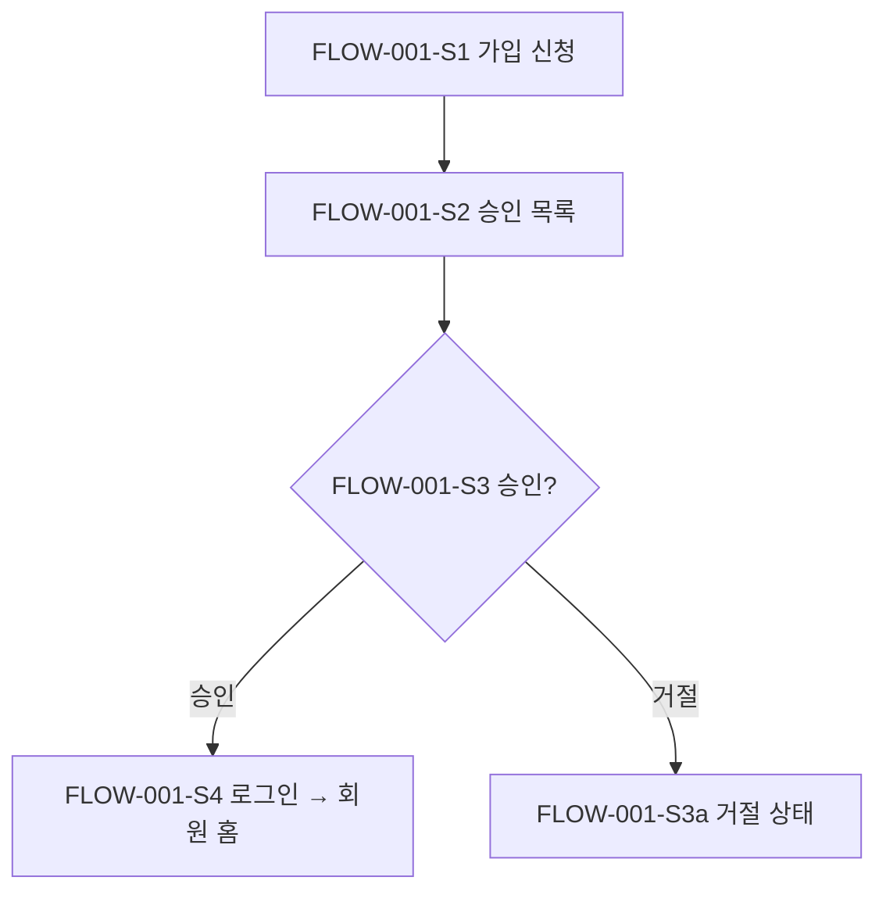
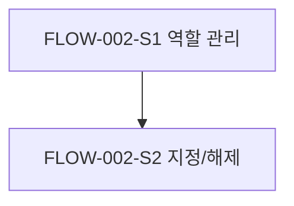
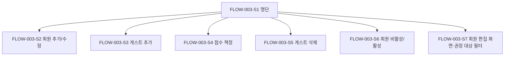
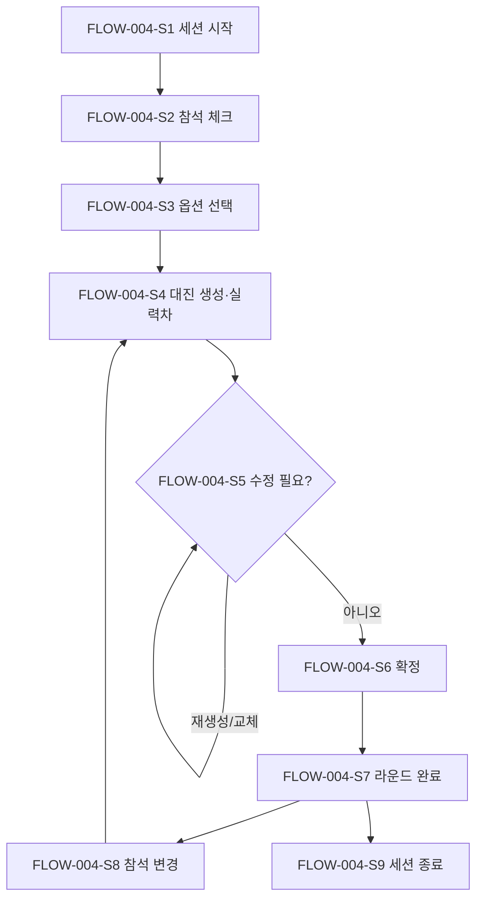
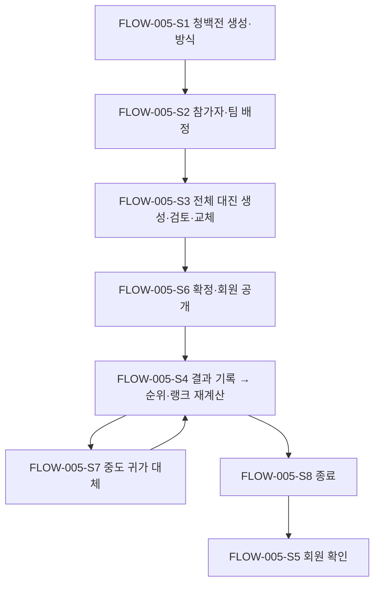
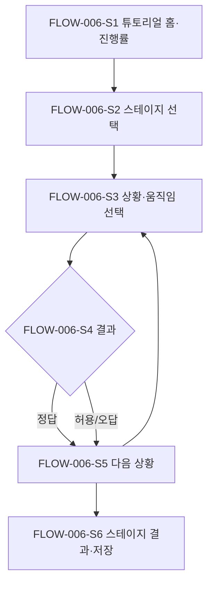
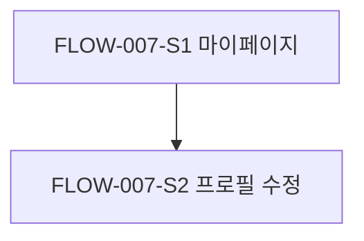
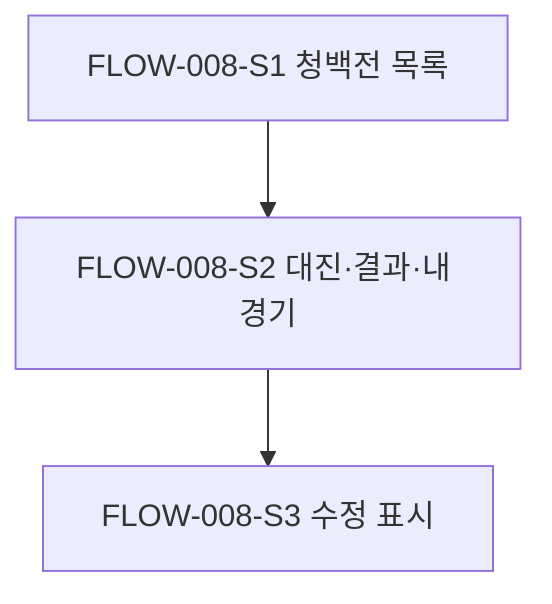

# 사용자 플로우 (User Flows): badminton-playbook

> **r3 개정**: PF-001~006 반영. FLOW-005(청백전)와 FLOW-006(튜토리얼)을 재작성했고 FLOW-008(회원 청백전 조회)을 추가했습니다. 단계 ID는 재사용하지 않습니다. 재작성한 플로우는 r2 단계 ID를 같은 역할의 단계에 유지하고, 새 단계는 다음 번호부터 붙였기 때문에 표의 단계 순서와 번호 순서가 다를 수 있습니다.

> **r4 개정**: 세션 날짜·종료 규칙(C-25)과 청백전 참가 게스트 삭제 제한(C-26)을 반영했습니다. FLOW-004-S9의 시스템 반응을 보완하고 대안 경로 FLOW-004-S1a·S9a·S9b, FLOW-003-S5b·S5c·S5d를 추가했습니다. 기존 단계 ID는 바꾸지 않았습니다.

## FLOW-001: 가입 신청 → 승인 → 로그인

- **행위자**: PER-001 회원, PER-002 운영진
- **커버하는 스토리**: US-001, US-002, US-003
- **진입 조건**: 아직 가입하지 않은 사람이 서비스에 접속합니다.
- **종료 / 성공 상태**: 승인된 회원이 로그인해 회원 홈에 들어갑니다.

| 단계 | 사용자 행동 | 시스템 반응 |
|---|---|---|
| FLOW-001-S1 | 회원이 '카카오로 시작하기'를 눌러 카카오 인증을 마칩니다. 처음 로그인하면 이름, 성별, (r3) 급수(8개 중 선택, 필수), 누구의 지인인지(선택)를 입력하고 제출합니다. | 카카오 계정 식별자로 계정을 만들고 '승인 대기' 상태로 둡니다. "운영진 승인 후 이용할 수 있습니다"라고 안내합니다. |
| FLOW-001-S2 | 운영진이 가입 승인 목록을 엽니다. | 승인 대기 중인 신청자를 신청 순서대로 보여 줍니다. (r3) 신청자마다 이름, 성별, 급수, 지인 정보를 함께 보여 줍니다. |
| FLOW-001-S3 | 운영진이 신청자를 승인합니다. | 계정을 '승인'으로 바꾸고 회원 명단에 넣습니다. 점수는 '미설정'으로 둡니다. |
| FLOW-001-S4 | 회원이 카카오 로그인으로 들어옵니다. | 역할을 확인하고 회원 홈으로 보냅니다. 운영진 이상이면 운영 메뉴도 보여 줍니다. |

**대안 / 오류 경로**

- FLOW-001-S1a: 이름, 성별, (r3) 급수 중 하나라도 입력하지 않으면 오류를 보여 주고 다시 입력하게 합니다. 지인 정보는 비워도 됩니다.
- FLOW-001-S1b: 이미 가입한 카카오 계정이면 새 계정을 만들지 않고 기존 계정으로 로그인합니다.
- FLOW-001-S1c: 카카오 인증을 취소하거나 인증에 실패하면 로그인 화면으로 돌아가 다시 시도하게 안내합니다.
- FLOW-001-S3a: 운영진이 거절하면 계정을 '거절' 상태로 바꿉니다. 이 계정으로는 로그인해도 회원 기능을 쓸 수 없습니다.
- FLOW-001-S4a: 승인 대기 중이거나 거절된 계정으로 로그인하면, 회원 기능 대신 계정 상태 안내를 보여 줍니다.

## FLOW-002: 운영진 지정과 해제

- **행위자**: PER-003 슈퍼 관리자
- **커버하는 스토리**: US-004
- **진입 조건**: 슈퍼 관리자가 로그인해 있습니다.
- **종료 / 성공 상태**: 대상 회원의 역할이 바뀌고, 바뀐 역할이 다음 요청부터 적용됩니다.

| 단계 | 사용자 행동 | 시스템 반응 |
|---|---|---|
| FLOW-002-S1 | 슈퍼 관리자가 '역할 관리' 화면을 엽니다. | 승인된 회원 목록과 각 회원의 역할을 보여 줍니다. |
| FLOW-002-S2 | 회원을 골라 '운영진 지정' 또는 '운영진 해제'를 누릅니다. | 확인 창을 띄운 뒤 역할을 바꾸고 결과를 보여 줍니다. |

**대안 / 오류 경로**

- FLOW-002-S1a: 운영진이 역할 관리 화면에 접근하면 권한 오류를 보여 주고, 화면 진입과 API 호출을 모두 막습니다.

## FLOW-003: 회원 명단, 게스트, 점수 관리

- **행위자**: PER-002 운영진
- **커버하는 스토리**: US-005, US-006, US-007, US-020, US-026
- **진입 조건**: 운영진이 로그인해 있습니다. PC와 모바일 모두에서 진행할 수 있습니다.
- **종료 / 성공 상태**: 회원과 게스트 정보, 점수가 저장됩니다.

| 단계 | 사용자 행동 | 시스템 반응 |
|---|---|---|
| FLOW-003-S1 | 운영진이 명단 화면을 엽니다. | 회원과 게스트를 구분해 이름, 성별, 점수를 보여 줍니다. |
| FLOW-003-S2 | '회원 추가'로 이름, 성별, (r3) 급수, 점수를 입력하거나 기존 회원 정보(급수 포함)를 수정합니다. | 입력값을 검사해 저장하고 명단에 반영합니다. |
| FLOW-003-S3 | '게스트 추가'로 이름, 성별, (r3) 급수, 점수를 입력합니다. | 게스트로 저장합니다. 게스트는 랭크 대상에서 빠집니다. |
| FLOW-003-S4 | 회원이나 게스트의 점수를 1–10 중에서 고릅니다. | 점수를 저장합니다. |
| FLOW-003-S5 | 게스트를 삭제합니다. | 확인 창을 띄운 뒤 게스트를 지우고, 지난 기록에는 '삭제된 게스트'로 표시합니다(ASM-019). |
| FLOW-003-S6 | 회원을 비활성으로 바꾸거나 다시 활성화합니다. 이 단계는 Should입니다. | 비활성 회원은 참석 체크 목록에서 숨기고, 회원 기능도 막습니다. 청백전 기록은 그대로 남깁니다. 다시 활성화하면 원래 상태로 돌아갑니다. |
| FLOW-003-S7 | (r3) 회원 편집 화면을 엽니다. 필요하면 '튜토리얼 권장 대상 · 미통과' 필터로 회원을 골라 봅니다. | 그 회원의 급수, 지인 정보, 랭크(또는 랭크 없음과 남은 경기 수), 누적 청백전 전적, 튜토리얼 통과 현황을 보여 줍니다. 게스트에는 랭크·전적·튜토리얼 현황이 없습니다. 권장 대상은 1–10 점수 3 이하 또는 미설정인 승인 회원입니다(C-23). |

**대안 / 오류 경로**

- FLOW-003-S2a: (r3) 급수를 고르지 않으면 회원·게스트를 저장하지 않고 오류를 보여 줍니다.
- FLOW-003-S4a: 1–10 범위를 벗어난 값이나 정수가 아닌 값은 저장하지 않고 오류를 보여 줍니다.
- FLOW-003-S5a: 진행 중인 라운드에 출전한 게스트는 삭제할 수 없습니다. 라운드가 끝난 뒤에 삭제하라고 안내합니다.
- FLOW-003-S5b: (r4) 확정된 미종료 청백전에서 결과가 기록되지 않은 경기에 포함된 게스트는 삭제할 수 없습니다. 어느 청백전의 몇 경기에 포함되어 있는지 알리고, 먼저 대체 선수를 정하라고 안내합니다(C-26, FLOW-005-S7).
- FLOW-003-S5c: (r4) 확정 전 청백전의 미확정 대진이나 실시간 대진의 확정 전 대진에 포함된 게스트를 삭제하면, 그 대진이 폐기된다는 확인 창을 띄웁니다. 확인하면 대진 폐기와 게스트 삭제를 함께 처리하고, 처리에 실패하면 둘 다 반영하지 않습니다(C-26).
- FLOW-003-S5d: (r4) 대진에는 없고 청백전 참가자로만 등록된 게스트를 삭제하면, 게스트 삭제와 그 청백전 참가자 명단에서의 제거를 함께 처리합니다. 처리에 실패하면 둘 다 반영하지 않습니다(C-26).

## FLOW-004: 운동 당일 실시간 대진 (핵심 플로우)

- **행위자**: PER-002 운영진
- **커버하는 스토리**: US-008, US-009, US-010, US-011, US-012, US-013, US-021, US-022
- **진입 조건**: 운영진이 로그인해 있고, 회원과 게스트의 점수와 성별이 등록되어 있습니다.
- **종료 / 성공 상태**: 그날 여러 라운드를 진행했고, 같은 날 같은 경기가 반복되지 않았으며, 게임 수가 고르게 배분됐습니다.

| 단계 | 사용자 행동 | 시스템 반응 |
|---|---|---|
| FLOW-004-S1 | 운영진이 '오늘 운동 시작'으로 세션을 엽니다. | 오늘 날짜의 세션을 만들고 참석 체크 화면을 보여 줍니다. |
| FLOW-004-S2 | 회원 명단에서 참석자를 체크하고, 필요하면 게스트를 추가합니다. | 참석 인원과 성별 분포를 보여 줍니다. |
| FLOW-004-S3 | 생성 방식(레벨별 또는 무작위)을 고르고, 규칙 4가지를 켜거나 끕니다. | 옵션을 저장합니다. 다음 라운드에서도 같은 옵션을 기본으로 씁니다. |
| FLOW-004-S4 | '대진 생성'을 누릅니다. | 공평성 기준으로 출전자를 고르고, 코트 수(4)만큼 경기를 생성합니다. 남는 인원은 대기자로 표시합니다. 완화된 규칙이 있으면 경기별로 표시합니다. (r3) 경기마다 '1팀 / 2팀'과 '실력차 N점'을 보여 줍니다(C-24). |
| FLOW-004-S5 | 대진을 검토하고, 필요하면 '다시 생성'을 누릅니다(Must). 선수를 직접 맞바꾸는 기능은 Should입니다(US-021). | 다시 생성하면 새 시드로 새 결과를 만들어 보여 줍니다. 맞바꾸면 바뀐 대진을 보여 줍니다. (r3) 맞바꿀 후보마다 교체 후 예상 실력차를 보여 주고, 교체하면 실력차를 즉시 다시 계산합니다. |
| FLOW-004-S6 | '확정'을 누릅니다. | 라운드를 '진행 중'으로 바꾸고 코트별 경기를 보여 줍니다. (r3) 확정 후에도 운영진 화면에 실력차를 표시합니다. |
| FLOW-004-S7 | 4경기가 모두 끝나면 '라운드 완료'를 누릅니다. | 게임 수, 파트너, 상대, 대기 기록을 세션 이력에 쌓습니다. |
| FLOW-004-S8 | 늦게 온 사람을 참석에 추가하거나 먼저 간 사람을 뺀 뒤, 다시 S4로 돌아갑니다. | 바뀐 참석자와 세션 이력을 반영해 다음 라운드를 생성합니다. 직전 라운드 대기자를 먼저 배정합니다. |
| FLOW-004-S9 | 운동이 끝나면 '세션 종료'를 누릅니다. | 세션을 종료합니다. 종료된 세션에서는 더 이상 라운드를 생성할 수 없습니다. (r4) 종료 전 확인 창에서 종료한 세션은 복구할 수 없고 같은 날짜에 새 세션을 만들 수 없다고 안내합니다(C-25). |

**대안 / 오류 경로**

- FLOW-004-S1a: (r4) 오늘(생성 시점의 KST 날짜) 세션이 이미 있으면 새로 만들지 않고 그 세션을 엽니다. 오늘 세션이 이미 종료되었으면 새 세션을 만들 수 없다고 안내합니다. 자정을 넘겨도 진행 중인 세션의 날짜는 바뀌지 않습니다. 전날 세션이 종료되지 않았더라도 오늘 날짜의 새 세션을 만들 수 있고, 전날 세션은 자동 종료하거나 오늘 세션으로 이어 쓰지 않습니다. 운영진은 전날 미종료 세션에 다시 접근해 이어서 진행하거나 종료할 수 있으며, 오늘 새 세션은 참석자·대진·경기 이력을 이어받지 않습니다(C-25).
- FLOW-004-S4a: 참석자가 4명 미만이면 대진을 생성하지 않고 "최소 4명이 필요합니다"라고 안내합니다.
- FLOW-004-S4b: 참석자가 16명 미만이거나 4의 배수가 아니면, 4명 단위로 채울 수 있는 코트만큼만 경기를 만들고 나머지는 대기자로 표시합니다.
- FLOW-004-S4c: 켜진 규칙을 모두 만족할 수 없으면 우선순위가 낮은 규칙부터 완화하고, 어떤 규칙이 완화됐는지 표시합니다(US-013). 혼복 우선 규칙에서 불가피하게 불균형 조합이 생기면 해당 경기에 '성별 규칙 완화'를 표시합니다(C-03).
- FLOW-004-S6a: 확정하는 순간 다른 운영진이 같은 세션을 이미 바꿨다면, 충돌을 안내하고 최신 상태를 다시 불러옵니다(C-10).
- FLOW-004-S8a: 진행 중인 라운드에서 선수를 참석에서 빼도 현재 경기는 그대로 둡니다. 그 선수는 다음 라운드부터 빠집니다(ASM-016).
- FLOW-004-S9a: (r4) 진행 중인 라운드가 있으면 세션을 종료하지 않고 라운드를 먼저 완료하라고 안내합니다(C-25).
- FLOW-004-S9b: (r4) 진행 중인 라운드 없이 확정 전 대진만 있으면, 그 대진이 폐기된다는 내용을 종료 확인 창에 함께 안내하고 확인하면 대진을 폐기하고 세션을 종료합니다(C-25).

## FLOW-005: 청백전 운영과 결과 반영 *(r3 재작성)*

- **행위자**: PER-002 운영진
- **커버하는 스토리**: US-014, US-015, US-016, US-022
- **진입 조건**: 운영진이 로그인해 있습니다. 회원의 참가 신청 단계는 없습니다.
- **종료 / 성공 상태**: 확정된 대진의 모든 경기 결과가 기록되어 청백전이 종료되고, 개인전 순위 또는 팀전 결과가 확정되며, 참가 회원의 랭크가 다시 계산됩니다.

| 단계 | 사용자 행동 | 시스템 반응 |
|---|---|---|
| FLOW-005-S1 | 운영진이 청백전 메뉴에서 '청백전 만들기'를 누르고 날짜, 이름, 방식(개인전 또는 팀전)을 입력합니다. | 청백전을 만듭니다. 일반 운동 세션과는 따로 저장합니다. |
| FLOW-005-S2 | 참가 선수(회원·게스트)를 선정합니다. 팀전이면 알고리즘이 만든 청·백 배정안을 보고 조정합니다. | 참가 인원과 성별 분포를 보여 줍니다. 팀전은 점수 합과 성별 비율이 비슷한 청·백 배정안을 제안하고 팀별 인원을 보여 줍니다(C-19). |
| FLOW-005-S3 | 총 경기 수와 규칙(밸런스, 성별 조합)을 정하고 '대진 생성'을 누른 뒤, 생성된 대진을 검토하며 필요하면 '다시 생성'하거나 선수를 맞바꿉니다. | 결정적 알고리즘으로 전체 대진을 한 번에 만듭니다. 선수별 경기 수 차이는 최대 1입니다(C-14). 경기마다 '1팀 / 2팀'(팀전은 '청팀 / 백팀')과 '실력차 N점'을 보여 주고, 맞바꿀 후보마다 교체 후 예상 실력차를 보여 줍니다(C-24). |
| FLOW-005-S6 | (r3 신규) '확정'을 누릅니다. | 확인 창을 거쳐 대진을 확정하고 회원에게 공개합니다(FLOW-008). 확정 후에는 방식을 바꾸거나 경기를 다시 생성할 수 없습니다. |
| FLOW-005-S4 | 경기가 끝나면 이긴 쪽(개인전: 1팀/2팀, 팀전: 청/백)을 기록합니다. | 결과를 저장하고 개인전 순위(누적 승수, 공동 순위, 경기 수) 또는 청·백 팀 승수를 다시 계산하며, 그 경기에 나온 회원의 전적과 랭크를 다시 계산합니다(C-16, C-17). |
| FLOW-005-S7 | (r3 신규) 먼저 간 선수를 '이후 대진에서 제외'하고, 그 선수의 남은 경기마다 대체 선수를 고릅니다. | 결과가 기록되지 않은 남은 경기를 보여 주고 경기 수가 적은 참가자부터 대체 후보로 추천합니다. 교체를 반영하고 회원 화면에 '대진이 수정되었습니다'를 표시합니다. 귀가자의 기존 경기와 결과는 그대로 둡니다(C-15). |
| FLOW-005-S8 | (r3 신규) 모든 경기 결과가 기록되면 '청백전 종료'를 누릅니다. | 확인 창을 거쳐 청백전을 종료하고, 개인전은 최종 순위, 팀전은 승리 팀 또는 무승부를 확정해 보여 줍니다(C-20). |
| FLOW-005-S5 | 회원이 청백전 화면과 마이페이지를 엽니다. | 확정된 대진, 결과, 순위 또는 팀 승수(FLOW-008)와 바뀐 랭크·전적(FLOW-007)을 보여 줍니다. |

**대안 / 오류 경로**

- FLOW-005-S2a: 게스트도 참가하고 팀에 배정할 수 있습니다. 게스트가 함께 뛴 경기에서도 회원의 승패는 랭크에 반영되고, 게스트는 랭크를 받지 않습니다. 개인전 순위표에는 '게스트' 표시와 함께 나옵니다(C-09, C-16).
- FLOW-005-S2b: (r3) 참가자 중 1–10 점수가 미설정인 사람이 있으면 대진을 생성할 수 없고, 그 사람의 점수를 먼저 매기도록 안내합니다(C-19).
- FLOW-005-S3a: 같은 4명이 같은 팀 구성으로 만나는 경기, 팀전에서 청 2 대 백 2가 아닌 경기, 한 경기에 같은 선수가 두 번 들어간 경기는 생성하지 않고, 이런 경기가 되는 교체는 할 수 없습니다(C-19).
- FLOW-005-S3b: (r3) 입력한 총 경기 수로는 모두 같은 경기 수가 될 수 없으면, 모두 같아지는 가까운 총 경기 수를 제안합니다. 운영진이 입력값을 유지하면 차이 최대 1로 만들고 순위표에 사람별 경기 수를 표시합니다(C-14).
- FLOW-005-S3c: (r3) 확정 전에 방식을 바꾸면 확인 창을 거쳐 미확정 대진을 버리고, 참가자는 유지하며 팀 배정은 초기화합니다(C-13).
- FLOW-005-S3d: (r3) 수동 교체로 선수 간 경기 수 차이가 2 이상이 되면 경고를 보여 주되 교체는 허용합니다(C-14). 개별 경기 추가·삭제는 없고, 경기 수를 바꾸려면 총 경기 수를 고쳐 다시 생성합니다.
- FLOW-005-S6a: (r3) 확정, 선수 교체, 결과 입력·수정, 방식 변경, 종료 순간에 다른 운영진이 이미 바꿨다면 처리하지 않고 충돌을 안내한 뒤 최신 상태를 보여 줍니다(C-10, C-19).
- FLOW-005-S6b: (r3) 확정 후에는 결과가 기록되지 않은 경기의 선수 교체만 할 수 있습니다(C-15).
- FLOW-005-S4a: 승패를 잘못 기록했으면 종료 전후 모두 확인을 거쳐 수정할 수 있습니다. 수정하면 순위·팀 승수·랭크를 다시 계산합니다.
- FLOW-005-S4b: (r3) 확정 전에는 결과를 기록할 수 없습니다(C-20).
- FLOW-005-S8a: (r3) 결과가 기록되지 않은 경기가 남아 있으면 종료할 수 없고, 남은 경기를 안내합니다.
- FLOW-005-S8b: (r3) 팀전에서 청·백 팀 승수가 같으면 최종 결과는 무승부입니다. 결정전 경기는 추가하지 않습니다(C-16).

## FLOW-006: 게임형 로테이션 튜토리얼 *(r3 재작성)*

- **행위자**: PER-001 회원
- **커버하는 스토리**: US-024, US-025
- **진입 조건**: 승인된 회원이 로그인해 있습니다. 화면은 세로 모바일 레이아웃입니다.
- **종료 / 성공 상태**: 회원이 스테이지를 끝내고 통과 여부와 점수를 확인하며, 통과 기록이 저장됩니다.

| 단계 | 사용자 행동 | 시스템 반응 |
|---|---|---|
| FLOW-006-S1 | 회원이 튜토리얼 메뉴를 엽니다. | 튜토리얼 난이도(입문자, 왕초보, 초보, D조 이상)와 스테이지를 모두 열린 상태로 보여 주고, 본인의 스테이지 통과 여부·최고 점수·난이도별 진행률을 보여 줍니다. 모든 회원에게 같은 안내('처음이라면 입문자부터')를 보여 줍니다(C-22, C-23). |
| FLOW-006-S2 | 스테이지를 고릅니다. | 2D 탑뷰 코트에 첫 상황(선수·파트너·상대 위치)을 보여 줍니다. |
| FLOW-006-S3 | 상대 타구가 날아오면 화면이 멈추고, 회원이 움직임(앞으로, 뒤로, 옆으로, 위치 유지 등)을 고릅니다. | 고른 움직임에 따라 선수와 셔틀콕 애니메이션과 랠리 결과를 보여 줍니다. |
| FLOW-006-S4 | 결과를 확인합니다. | 정답이면 득점 표시와 이유를 보여 주고 다음 상황으로 갑니다. 첫 시도 정답만 1점입니다(C-22). |
| FLOW-006-S5 | (r3 신규) 다시 도전하거나 다음 상황으로 넘어갑니다. | 같은 상황을 다시 보여 주거나 다음 상황으로 갑니다. 재도전으로 맞히면 0점입니다. |
| FLOW-006-S6 | (r3 신규) 스테이지의 마지막 상황을 마칩니다. | 점수와 통과 여부(상황 수의 70% 이상)를 보여 주고, 통과 여부·최고 점수·최초 통과 시각을 저장합니다. 상황별 선택 기록은 저장하지 않습니다(C-23). |

**대안 / 오류 경로**

- FLOW-006-S1a: 로그인하지 않았거나 승인되지 않은 사용자가 튜토리얼 페이지에 접근하면 로그인 화면이나 계정 상태 안내로 보냅니다.
- FLOW-006-S1b: (r3) MVP1에서 콘텐츠가 없는 난이도(초보, D조 이상)는 '준비 중'으로 표시하고 플레이할 수 없습니다(C-22).
- FLOW-006-S4a: (r3) 허용 가능한 선택이면 득점·실점 없이 랠리가 이어지는 연출과 '더 좋은 움직임' 설명, 최선 움직임 보기, '다시 도전'을 보여 줍니다(0점).
- FLOW-006-S4b: (r3) 오답이면 실점 장면과 이유, 정답 움직임 보기, '다시 도전'을 보여 줍니다.
- FLOW-006-S6a: (r3) 통과하지 못하면 '다시 하기'를 안내합니다. 이전에 저장한 최고 점수보다 낮으면 최고 점수는 바꾸지 않습니다.

## FLOW-007: 마이페이지

- **행위자**: PER-001 회원
- **커버하는 스토리**: US-019, US-016
- **진입 조건**: 승인된 회원이 로그인해 있습니다.
- **종료 / 성공 상태**: 회원이 자기 프로필, 랭크, 청백전 전적을 확인하고, 필요하면 프로필을 수정합니다.

| 단계 | 사용자 행동 | 시스템 반응 |
|---|---|---|
| FLOW-007-S1 | 회원이 마이페이지를 엽니다. | 프로필(이름, 성별, (r3) 급수), 랭크(또는 '랭크 없음'과 남은 경기 수), 청백전 전적(경기 수, 승, 패, 승률)을 보여 줍니다. 1–10 점수는 보여 주지 않습니다. (r3) 청백전별 기록은 회원 청백전 화면(FLOW-008)으로 연결합니다. |
| FLOW-007-S2 | 프로필 수정에서 이름, 성별, (r3) 급수를 바꾸고 저장합니다. | 입력값을 검사해 저장합니다. |

**대안 / 오류 경로**

- FLOW-007-S1a: 청백전 기록이 없으면 "청백전 기록이 없습니다"를 보여 줍니다.

## FLOW-008: 회원 청백전 조회 *(r3 신규)*

- **행위자**: PER-001 회원
- **커버하는 스토리**: US-023
- **진입 조건**: 승인된 회원이 로그인해 있습니다.
- **종료 / 성공 상태**: 회원이 확정된 청백전의 대진과 결과, 자기 경기를 확인합니다.

| 단계 | 사용자 행동 | 시스템 반응 |
|---|---|---|
| FLOW-008-S1 | 회원이 청백전 화면을 엽니다. | 확정·공개된 청백전 목록을 보여 줍니다. 확정 전 청백전은 보여 주지 않습니다(C-18). |
| FLOW-008-S2 | 청백전 하나를 고릅니다. | 전체 대진과 결과, 개인전 순위(승수, 경기 수, 게스트 표시) 또는 팀전 청·백 승수를 보여 주고 본인 경기를 강조합니다. 1–10 점수, 팀 점수 합, 실력차, 다른 회원의 랭크는 보여 주지 않습니다(NFR-005). |
| FLOW-008-S3 | 대진이 수정된 뒤 다시 엽니다. | '대진이 수정되었습니다(시각)'와 바뀐 경기 표시를 보여 줍니다. 알림은 보내지 않습니다(C-15). |

**대안 / 오류 경로**

- FLOW-008-S1a: 공개된 청백전이 없으면 "아직 공개된 청백전이 없습니다" 안내와 지난 청백전 기록(있으면)을 보여 줍니다.

## UI 플로우가 없는 스토리 (Stories without UI flow)

없음. US-016(랭크 산정)은 시스템이 하는 계산이지만, FLOW-005-S4(재계산)와 FLOW-007-S1(표시)에 포함됩니다. (r3) ~~US-017~~·US-018은 폐기되었습니다.
